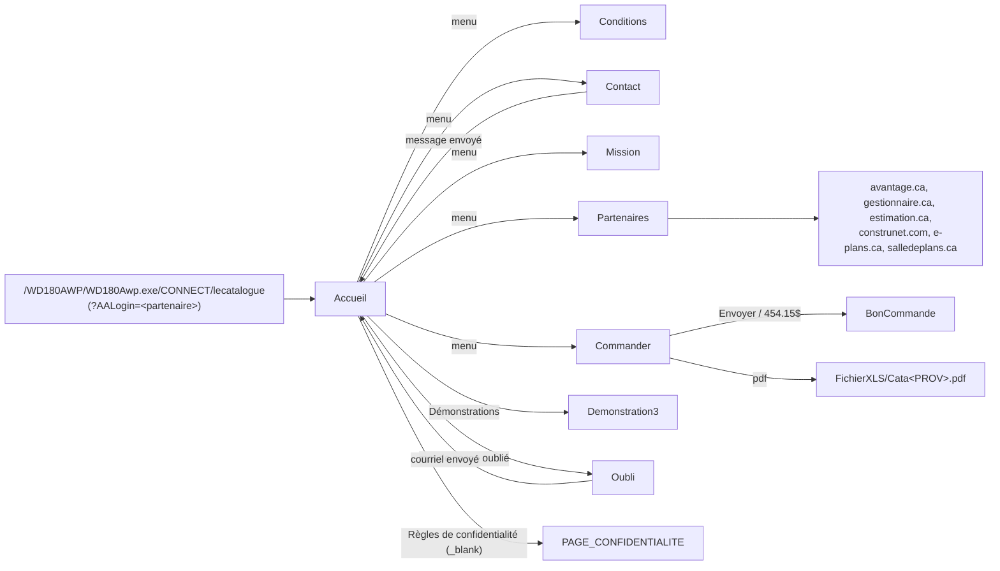
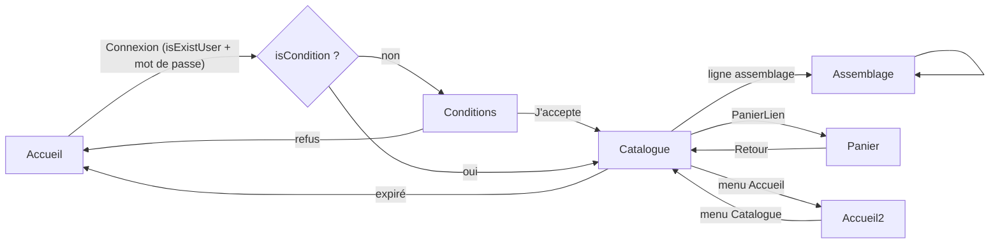
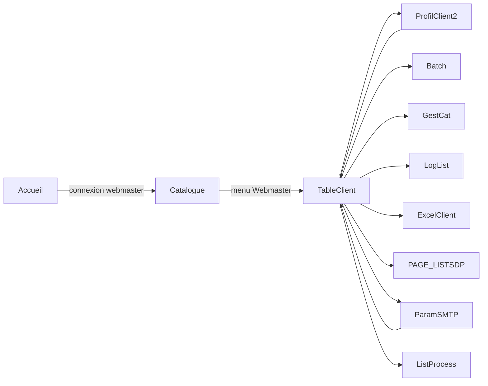
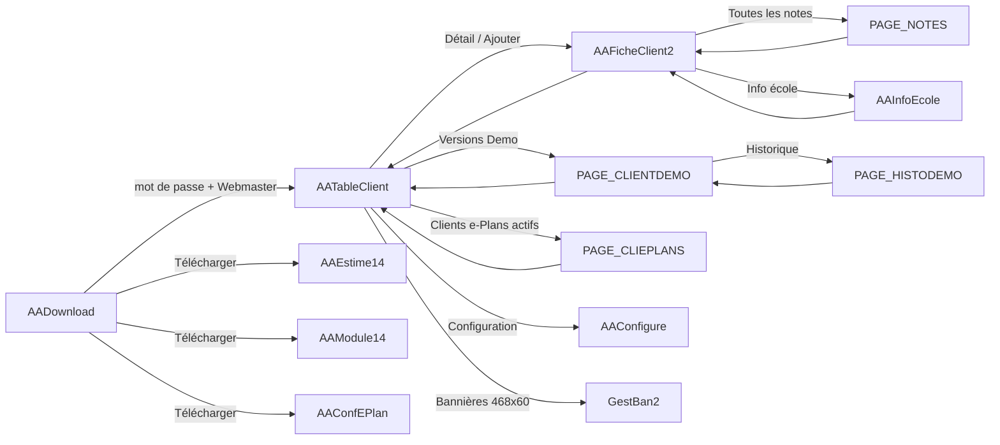
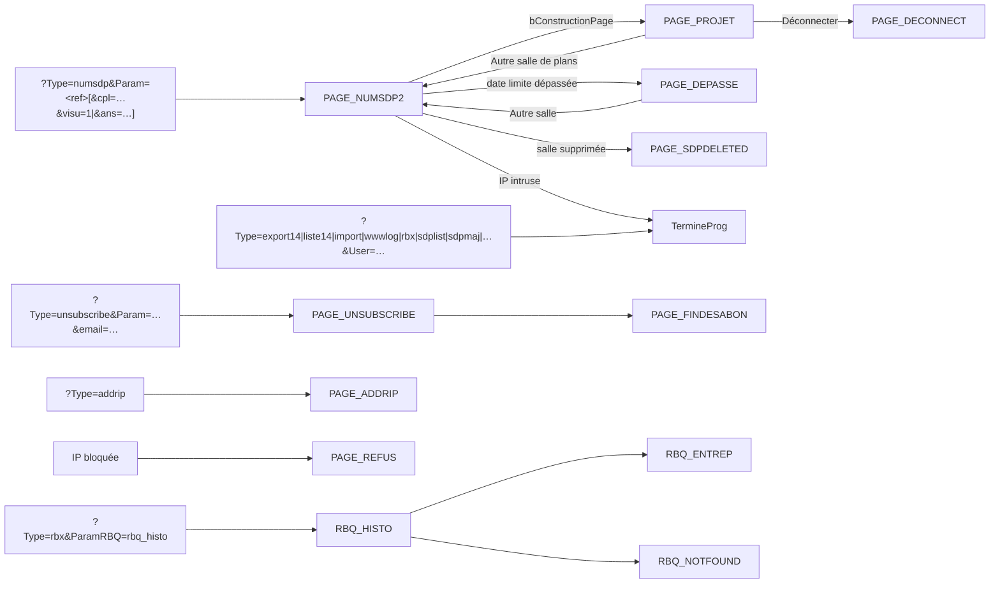

# A1 — Inventaire des 60 pages et de la navigation (lecatalogue.ca, WebDev 18)

Source principale : `Docs/dossier-technique.txt` (impression WebDev du 2026-10-01). Les repères « p. N » renvoient
aux marqueurs `--- page N ---` de ce fichier ; les « l. a-b » sont des numéros de ligne du même fichier.
Compléments : `.claude/docs/pages.md` (dates), gabarits `FR/*.htm` et `UK/*.htm`, `www/`, `.htaccess`,
site public https://lecatalogue.ca (pages publiques seulement, aucune connexion).

## 0. Constats structurants (à lire avant le reste)

1. **Ce n'est pas un site AWP mais un « Site dynamique WebDev » en mode session** (Tableau de bord du projet,
   p. 109 : « Type : Site dynamique WebDev » ; « Première page dynamique : Accueil », p. 102). Conséquences :
   - une seule URL d'entrée : `/WD180AWP/WD180Awp.exe/CONNECT/lecatalogue[?param=…]` (les pages ne sont **pas**
     adressables par URL : `…/CONNECT/lecatalogue/Partenaires` renvoie l'erreur WebDev « site inconnu,
     ERR_NO_APPLICATION » — vérifié en ligne) ;
   - l'état est en mémoire serveur dans la session (`goConfig`, `goClient`, `goAAClient`… variables globales du
     projet, p. 118-124), pas dans des cookies ni des contextes AWP ; aucun appel `Cookie*`, `AWPContexte*`
     ni `AWP*` dans tout le dossier (grep) ;
   - le code d'initialisation du projet (p. 111-141) s'exécute **à chaque nouvelle session** : il lit les paramètres
     d'URL avec `PageParamètre()` puis dispatche (`SELON Minuscule(AAType)`) soit vers une page, soit vers un
     traitement « machine » terminé par `PageAffiche(TermineProg)` ;
   - les pages PAGE_DEPASSE / PAGE_DECONNECT jouent le rôle des pages WebDev de fin de session (elles appellent
     `FinProgramme()` dans leur « Synchronisation »).
   - le serveur de production répond avec des ressources `/WD190AWP/wd190awp.exe/…` sur la page d'erreur
     (image `Imgerr.gif`) : le serveur d'application installé semble être WebDev 19 alors que le projet est en 18
     (non vérifié au-delà de cette observation).
2. **Mécanique de session « keep-alive »** : les pages Catalogue et AAFicheClient2 déclenchent un `Timer`
   navigateur (`Reconnexion`, 5 min moins 2 s ; 3 min pour la fiche) qui simule un clic sur un bouton serveur
   `BTN_RECONNECT` pour que la session WebDev ne tombe pas (Catalogue l. 25549-25560, 26083-26118 ;
   AAFicheClient2 l. 99529-99530, 101629).
3. **Le site est bilingue FR/GB dans l'éditeur, mais français à l'exécution** pour la partie catalogue : les
   gabarits `UK/*.htm` contiennent les mêmes textes français que `FR/` (ex. `UK/Accueil.htm` : seul « Privacy
   policies » change), les libellés GB du dossier sont le plus souvent la copie du FR. Seules les pages de salle
   de plans (PAGE_NUMSDP2, PAGE_PROJET, PAGE_SDPDELETED, PAGE_STATSDP, PAGE_UNSUBSCRIBE) basculent FR/EN à
   l'exécution par code (`Nation()`, procédure locale `TraiteLangue`). Voir § 6.
4. **Un seul modèle de page** `Modele_ActivXP_1` (bandeau + menu horizontal) partagé par les 22 pages « site
   catalogue ». Les pages AA*/PAGE_*/RBQ_* n'utilisent pas le modèle. Voir § 7.
5. **Trois publics distincts dans la même application** :
   - le site catalogue (visiteur + abonné `goClient`/`CClient` + webmaster catalogue `goConfig:isWebMaster()`) ;
   - le « Centre de mise à jour » des logiciels (clients `goAAClient`/`CAAClient`, entrée par `?AADownLoad=login`,
     administration AATableClient/AAFicheClient2) ;
   - la salle de plans virtuelle publique (entrée `?Type=numsdp&Param=<référence>`) et les commandes
     « machine » appelées par les logiciels Estimateur Général / e-Plans (`?Type=…&User=…`).

## 1. Tableau récapitulatif des 60 pages

Lignes = colonne « Lignes » des statistiques du projet (p. 144-145). Date = `.claude/docs/pages.md` (date du
`.wwh`). Statut : **A** active, **D** doublon remplacé, **M** probablement morte (aucun `PageAffiche`, aucun
« Page action » de lien, aucun cas du dispatcher), **S** système/technique.

| # | Page | Date | Lignes | Statut | Public | Rôle (une phrase) | Dossier technique |
|---|------|------|--------|--------|--------|-------------------|-------------------|
| 1 | AAConfEPlan | 2026-04-06 | 269 | A | client logiciel | Lance le téléchargement de l'installeur e-Plans puis se ferme | p. 1725, l. 58321-58568 |
| 2 | AAConfigure | 2026-04-03 | 382 | A (admin, legacy) | admin webmaster logiciels | Saisie des numéros de version 5/12 et envoi d'un courriel « nouvelle mise à jour » en lot à tous les AAClient | p. 1685, l. 56774-58320 |
| 3 | AAConfirmer | 2026-04-03 | 271 | M (remplacé par AAEstime12/14) | client logiciel | Ancienne page de téléchargement `estime.exe` (version news) | p. 1630, l. 55161-55407 |
| 4 | AADownload | 2026-05-13 | 836 | A | client logiciel + admin | « Centre de mise à jour de l'Estimateur Général » : page de connexion par mot de passe pour un login passé en URL, affiche abonnement/versions, boutons de téléchargement, accès webmaster | p. 1377, l. 45148-47083 |
| 5 | AAEstime12 | 2026-04-03 | 282 | A (legacy v12) | client logiciel | Téléchargement `InstallEG14.exe` (http) puis fermeture | p. 1639, l. 55408-55654 |
| 6 | AAEstime14 | 2026-04-06 | 282 | A | client logiciel | Téléchargement `InstallEG14.exe` (https) puis fermeture | p. 2288, l. 78187-78433 |
| 7 | AAFicheClient2 | 2026-06-09 | 3384 | A | admin webmaster logiciels | Fiche complète d'un client logiciel (licences, options, prix de renouvellement, notes, répertoires common, SDP, RBQ) | p. 2505, l. 86096-102382 |
| 8 | AAInfoEcole | 2026-04-03 | 500 | A | admin | Fiche « Information École » rattachée à un AAClient (version école) | p. 2463, l. 84518-86095 |
| 9 | AAModule12 | 2026-04-03 | 347 | A (legacy) | client logiciel | Téléchargement `InstallSRV14.exe` (http) puis fermeture | p. 1648, l. 55655-55902 |
| 10 | AAModule14 | 2026-04-06 | 347 | A | client logiciel | Téléchargement `InstallSRV14.exe` (https) puis fermeture | p. 2297, l. 78434-78681 |
| 11 | AARenouvelle | 2026-04-03 | 469 | M (code d'envoi entièrement commenté) | admin | Éditeur du texte de courriel de renouvellement e-Plans (`Renouvellement.html`) | p. 2440, l. 83713-84517 |
| 12 | AATableClient | 2026-06-10 | 3217 | A | admin webmaster logiciels | Table de tous les clients logiciels avec recherche, filtres, tris, statistiques, exports CSV, envois courriel | p. 1429, l. 47084-55160 |
| 13 | Accueil | 2026-04-03 | 577 | A (page d'entrée) | visiteur anonyme | Accueil public + formulaire de connexion au catalogue | p. 1311, l. 42835-45147 |
| 14 | Accueil2 | 2026-04-03 | 497 | A | abonné connecté | Accueil sans formulaire de connexion, affiché quand on est connecté et que les conditions sont acceptées | p. 1081, l. 34555-36088 |
| 15 | Assemblage | 2026-04-03 | 570 | A | abonné connecté | Détail d'un assemblage du catalogue (rendu en image PNG) | p. 704, l. 20837-21569 |
| 16 | Batch | 2026-04-03 | 578 | A | webmaster catalogue | Envoi d'un courriel HTML « il vous reste N jours » à tous les clients catalogue cochés Batch | p. 956, l. 30339-32912 |
| 17 | BonCommande | 2026-04-03 | 466 | A | visiteur | Page HTML statique « Bon de commande » (texte Word collé) après envoi du formulaire Commander | p. 1070, l. 34443-34554 |
| 18 | Catalogue | (absent de pages.md ; FR/Catalogue.htm 2005-02-02) | 1048 | A | abonné connecté | Consultation du catalogue : choix catalogue / division / section, recherche par mots, pagination, lignes rendues en PNG, lien vers Assemblage et Panier | p. 727, l. 21570-26143 |
| 19 | Catalogue2 | 2026-04-03 | 896 | M (aucun appelant) | abonné | Variante de Catalogue sans timer ni recherche par mots | p. 2338, l. 79754-83712 |
| 20 | Commander | 2026-04-03 | 684 | A | visiteur | Commande d'abonnement : bon de commande PDF (par télécopie) ou formulaire envoyé par courriel, enregistre dans `Commande` | p. 845, l. 26144-29759 |
| 21 | Conditions | 2026-04-03 | 569 | A | visiteur / abonné | Conditions d'utilisation (HTML statique) + acceptation obligatoire à la première connexion | p. 364, l. 8277-10125 |
| 22 | Contact | 2026-04-03 | 620 | A | visiteur | Formulaire « Nous joindre » (nom, courriel, message) envoyé par courriel au partenaire et à l'éditeur | p. 599, l. 17028-19119 |
| 23 | Demonstration | 2026-04-03 | 541 | D (remplacé par Demonstration3) | visiteur | Ancienne page démonstration (HTML Word + image) | p. 1244, l. 40603-42265 |
| 24 | Demonstration3 | 2026-04-03 | 540 | A | visiteur | Page « Démonstrations » : « Le guide est disponible de deux façons » + HTML | p. 1972, l. 67619-69272 |
| 25 | ExcelClient | 2026-04-03 | 591 | A | webmaster catalogue | Table RAD du fichier `Client` (liaison fichier, « Exporter vers excel ») | p. 1292, l. 42266-42834 |
| 26 | GestBan2 | 2026-04-03 | 524 | A | admin logiciels | Gestion des bannières 468×60 (`Banniere2`) : upload image, lien, pourcentage | p. 1661, l. 55971-56773 |
| 27 | GestCat | 2026-04-03 | 538 | A | webmaster catalogue | Suppression de catalogues (`Multicat`) autres que le catalogue par défaut | p. 585, l. 16623-17027 |
| 28 | ListProcess | 2026-04-03 | 718 | A | webmaster catalogue | Liste et tue les processus serveur (`RecupEntrep.exe`, `wd180session.exe`) via API Windows | p. 1804, l. 61264-63229 |
| 29 | LogList | 2026-04-03 | 562 | A | webmaster catalogue | Journal `Historique` (connexions, imports/exports, bons de commande) avec purge vers CSV | p. 938, l. 29760-30338 |
| 30 | Mission | 2026-04-03 | 554 | A | visiteur | Texte « Notre mission » (statique) | p. 1025, l. 32913-34442 |
| 31 | Oubli | 2026-04-03 | 631 | A | visiteur | Mot de passe oublié (catalogue) : envoi login + mot de passe **en clair** par courriel | p. 240, l. 3594-5374 |
| 32 | PAGE_ADDRIP | 2026-04-03 | 506 | S | logiciels (`Type=addrip`) | Renvoie l'adresse IP vue par le serveur | p. 2246, l. 76917-76989 |
| 33 | PAGE_CLIENTDEMO | 2026-05-13 | 875 | A | admin logiciels | Liste des installations DEMO (`ClientDemo`) avec filtre et verrouillage | p. 2916, l. 102559-103946 |
| 34 | PAGE_CLIEPLANS | 2026-05-13 | 700 | A | admin logiciels | Liste des clients e-Plans actifs | p. 2256, l. 77103-78186 |
| 35 | PAGE_CONFIDENTIALITE | 2026-04-03 | 510 | A | visiteur | Règles de confidentialité (HTML statique, 2017, Google Analytics/Adwords/Facebook) ouverte en `_blank` | p. 2250, l. 76990-77102 |
| 36 | PAGE_DECONNECT | 2026-04-03 | 512 | S | public SDP | « Au revoir / Bye bye » : termine la session (`FinProgramme`) | p. 2040, l. 69976-70214 |
| 37 | PAGE_DEPASSE | 2026-04-03 | 518 | S | public SDP | « Date limite dépassée » : la salle de plans est expirée ; termine la session | p. 2049, l. 70215-70518 |
| 38 | PAGE_ERRDESABON | 2026-04-03 | 513 | M (jamais affichée) | public | « Votre désabonnement a échoué » + feuillets produits | p. 2202, l. 75398-76178 |
| 39 | PAGE_FINDESABON | 2026-04-03 | 513 | A | public | « Votre désabonnement a été enregistré » + feuillets produits | p. 2179, l. 74617-75397 |
| 40 | PAGE_HISTODEMO | 2026-05-13 | 538 | A | admin logiciels | Historique des lancements d'une installation démo | p. 2954, l. 103947-104390 |
| 41 | PAGE_LISTSDP | 2026-04-03 | 575 | A | webmaster catalogue | Liste de toutes les salles de plans (`SDPInfo`) avec tailles | p. 2061, l. 70519-71850 |
| 42 | PAGE_NOTES | 2026-05-13 | 569 | A | admin logiciels | Édition de toutes les notes d'un client logiciel | p. 2225, l. 76179-76916 |
| 43 | PAGE_NUMSDP2 | 2026-04-03 | 703 | A | public SDP | Saisie / réception du numéro de salle de plans, contrôle anti-intrusion, ouvre PAGE_PROJET | p. 2128, l. 72902-73607 |
| 44 | PAGE_NUMSDPX | 2026-04-03 | 662 | M (remplacée par PAGE_NUMSDP2) | public SDP | Ancienne version de la page de numéro de salle de plans (avec texte promotionnel) | p. 2019, l. 69273-69975 |
| 45 | PAGE_PROJET | 2026-04-03 | 1524 | A | public SDP (sous-traitant invité) | La salle de plans : liste des plans à télécharger (un à un ou .zip), réponse OUI/NON/PEUT-ÊTRE avec captcha | p. 1858, l. 63230-67618 |
| 46 | PAGE_REFUS | 2026-04-03 | 554 | S | public | « Votre connexion a été refusée » puis `NavigateurFerme()` (IP bloquée) | p. 2908, l. 102383-102558 |
| 47 | PAGE_SDPDELETED | 2026-04-03 | 915 | A | public SDP | Salle supprimée / référence introuvable, avec coordonnées du client EG | p. 2307, l. 78682-79753 |
| 48 | PAGE_STATSDP | 2026-04-03 | 792 | M (aucun appelant ; code de stats commenté) | — | Statistiques de consultation d'une salle de plans | p. 2098, l. 71851-72901 |
| 49 | PAGE_UNSUBSCRIBE | 2026-04-03 | 712 | A | public (`Type=unsubscribe`) | Désabonnement de l'infolettre : vérifie la clé chiffrée, marque `COURRIEL_EXCLUS` dans un fichier HFSQL externe | p. 2150, l. 73608-74616 |
| 50 | PageBrouillon | 2026-04-03 | 572 | M | — | Page vide « Page brouillon » (gabarit de départ) | p. 1658, l. 55903-55970 |
| 51 | Panier | 2026-04-03 | 738 | A (fonctionnalité en partie désactivée) | abonné connecté | Panier d'items (fichier texte `<login>.txt`) avec suppression de ligne | p. 288, l. 5375-8276 |
| 52 | ParamSMTP | 2026-04-03 | 886 | A | webmaster catalogue | Paramètres SMTP écrits dans `lecatalogue.ini` (mot de passe chiffré via DllUtils) + courriel de test | p. 1735, l. 58569-61263 |
| 53 | Partenaires | 2026-04-03 | 629 | A | visiteur | Bannières cliquables vers les sites partenaires | p. 417, l. 10126-12073 |
| 54 | ProfilClient2 | 2026-04-03 | 944 | A | webmaster catalogue | Fiche d'un client catalogue (login/mot de passe, dates, provenance, catalogues autorisés, note, courriel) | p. 470, l. 12074-16622 |
| 55 | RBQ_ENTREP | 2026-04-03 | 606 | A | admin (`Type=rbx&ParamRBQ=rbq_histo`) | Fiche d'une entreprise RBQ : interdit / limite de transfert | p. 688, l. 20248-20836 |
| 56 | RBQ_HISTO | 2026-04-03 | 664 | A | admin | Historique des requêtes RBQ reçues des logiciels (filtres entreprise/IP/date) | p. 655, l. 19120-20167 |
| 57 | RBQ_NOTFOUND | 2026-04-03 | 590 | A | admin | « Entreprise non trouvée » (retour vers RBQ_HISTO) | p. 232, l. 3401-3593 |
| 58 | TableClient | 2026-04-03 | 854 | A | webmaster catalogue | Tableau de bord webmaster du catalogue : liste des clients, liens vers toutes les pages d'administration | p. 1126, l. 36089-40602 |
| 59 | TermineProg | 2026-04-03 | 593 | S | logiciels | Page vide qui termine la session (`FinProgramme`) après une commande machine | p. 685, l. 20168-20247 |
| 60 | WebDevOuiNon | 2026-04-03 (FR/.htm généré 2026-06-03) | 635 | S | tous | Boîte de dialogue Oui/Non interne de WebDev (`OuiNon()`/`Confirmer()` serveur, 16 usages) ; **code non imprimé dans le dossier** | listée p. 108 ; aucune section en Partie 3 |

Compte : 60 pages (liste des éléments p. 105-108 ; « Nombre de pages : 60 », p. 108 et 111). Le modèle
`Modele_ActivXP_1` (653 lignes) n'est pas une page.

Pages présentes dans `.claude/docs/pages.md` mais **hors projet** (fichiers orphelins, pas dans la liste p. 105-108) :
AAConfigure2, AAConfirmer3, AAFicheClient (remplacée par AAFicheClient2), Accueil.old, Demonstration2, FicheClient,
FrameCat, FrmCatalog, FrmCatalog2, GestBan, GestBanniere, GestBanniere2, MajCatalogue, Page1/2/3, PageTest,
ProfilClient (remplacée par ProfilClient2), Table_et_fiche_Itemcat. Les gabarits `FR/AAConfirmer2.htm`,
`FR/AAConfirmer4.htm`, `FR/AAFicheClient.htm`, `FR/PAGE_NUMSDP.htm`, `FR/PAGE_SDPDEL.htm` et les `Exe/*.awl`
correspondants sont des restes de générations antérieures. À ignorer dans la migration.

Particularité : `Catalogue.wwh` n'existe pas à la racine du dossier local (seul `FR/Catalogue.htm` daté 2005-02-02 et
`Exe/Catalogue.awl` existent) alors que la page est dans le dossier technique et appelée partout. Non vérifié :
emplacement réel du source.

## 2. Fiches par page

Convention des fiches : **Public** · **Paramètres** (`PROCEDURE` de la page + globales de session lues) · **Navigation
sortante** · **Champs / libellés** (FR | GB quand différent) · **Traitements** · **Emplacement**.

### 2.1 Site catalogue public (modèle ActivXP)

Toutes ces pages héritent du code du modèle (voir § 7) : Modele_Lien1 (Accueil/Accueil2), Modele_Lien2 (Catalogue
ou Conditions ou Accueil selon l'état), Modele_Lien6 (TableClient si `goConfig:isWebMaster()`, sinon « Accès non
autorisé »), et les liens statiques Conditions, Contact, Mission, Partenaires, Commander, Démonstrations.

#### Accueil — page d'entrée (« Première page dynamique »)
- Public : visiteur anonyme. Titre FR « Accueil » / GB « Welcome ».
- Paramètres : aucun `PROCEDURE`. Lit `goConfig:m_sProvenance` (provenance partenaire issue de `?AALogin=`),
  `goConfig:sGetTitre()` (titre « Le Catalogue - APECQ », etc.).
- Navigation : Bouton1 « Connexion » → Conditions (première fois) ou Catalogue ; Lien6 → Oubli ; LIEN_REGLE →
  PAGE_CONFIDENTIALITE (`_blank`) ; LienDemo → Demonstration3 ; menu du modèle.
- Champs : Saisie1 « Nom d'utilisateur », Saisie2 « Mot de passe », Bouton1 « Connexion », Libellé1 « Ouverture de
  session », Lien6 « Vous avez oublié votre mot de passe? », Html1 (texte d'accueil où `999` est remplacé par
  `HNbEnr(Itemcat)` = nombre d'items du catalogue). Texte en ligne vérifié : « Bienvenue… Un simple abonnement annuel
  de 395$ vous garantit l'accès en tout temps à plus de 8 000 articles. »
- Messages : « Codes invalides. Veuillez les vérifer svp... » (sic), « Votre abonnement est terminé, veuillez
  contacter votre fournisseur. »
- Traitements : connexion (voir § 4) ; écrit `Client.DateDerniereVisite` ; journalise dans `Historique`
  (HST_CONNECT, HST_BADPASSWORD, HST_BADUSER, HST_FINABONNEMENT). HTMLEntête : balise Google Analytics gtag (31
  pages la portent).
- Emplacement : p. 1311-1375 ; code l. 44992-45147.

#### Accueil2
- Public : abonné connecté ayant accepté les conditions (Modele_Lien1 y mène si `lnGetIdClient()<>0` et
  `isCondition()`). Titre GB « Reception ».
- Même contenu qu'Accueil sans le formulaire de connexion ; `LogIP("Accueil2 …")`.
- Emplacement : p. 1081-1125 ; code l. 36019-36088. Statut : active (pas un doublon : Accueil = anonyme, Accueil2 =
  connecté).

#### Conditions
- Public : visiteur (lecture) et abonné à la première connexion (acceptation).
- Paramètres : `goConfig:sGetLogin()`, `goClient:isCondition()`.
- Navigation : VALIDER/VALIDER1 → Catalogue si « J'accepte » (SELCOND=1) sinon `goConfig:SetLogin("")` + Accueil ;
  LIEN_REGLE → PAGE_CONFIDENTIALITE.
- Champs : Html1 (conditions d'utilisation, document Word 2005 « Les Services d'estimation G.S. inc. », CEGQ),
  SELCOND/SELCOND1 (sélecteurs accepte/refuse, masqués si non connecté ou déjà accepté), VALIDER « Valider ».
- Traitements : `goClient:SetCondition()` (flag FL_CONDITION du champ Flags) + `bModifie()`.
- Emplacement : p. 364-416 ; code l. 10024-10125.

#### Contact (« Nous joindre »)
- Public : visiteur.
- Champs : Saisie1 « Nom », Saisie2 « Courriel », Saisie3 « Suggestions, questions ou commentaires », Bouton1
  « Envoyer », Libellé3 = `goConfig:sGetAddrContact()` (coordonnées du partenaire ou de l'éditeur).
- Messages navigateur : « Veuillez inscrire votre nom / votre courriel / un message » ; serveur : « Le message a été
  envoyé » puis → Accueil.
- Traitements : courriel via `CEmail:bEnvoyerMail2(goDllUtils,…)` (DLL DllUtils, SMTP du .ini) au destinataire de la
  provenance (`goConfig:sGetDestinataire()`) + copie à l'éditeur si provenance partenaire ; adresses de copie codées
  en dur (à remplacer par configuration). Avertissement compilateur « EmailLitTimeOut interdite en Linux ».
- Emplacement : p. 599-654 ; code l. 18964-19119.

#### Commander
- Public : visiteur.
- Navigation : Lien11 « Télécharger le bon de commande (pdf) » → `FichierAffiche(goConfig:sGetBonCommandePDF())`
  (`LECATALOGUE_WEB/FichierXLS/Cata<PROVENANCE>.pdf`, ex. CataSERV.pdf, CataAPECQ.pdf…) ; Lien10 « Acrobat Reader »
  → adobe.com ; ENVOYER → BonCommande ; Lien12 « 454.15$ » → BonCommande.
- Champs : Nom, Prénom, Nom de la société, Fonction, Adresse de la société, Téléphone, Télécopieur, Code postal,
  Courriel (obligatoires sauf Fonction/Télécopieur) ; libellés « 1. Par télécopie », « 2. Par courriel », « Le règlement
  se fera par chèque au montant de 454.15$ (taxes comprises) à l'ordre de "Les Services Informatisés" », NumFax =
  télécopieur de la provenance.
- Traitements : écrit/maj `Commande` via `goCommande` (CCommande), `Historique` HST_BONCOMMANDESEND /
  HST_BONCOMMANDEPDF, 1 ou 2 courriels (destinataire provenance + copie éditeur).
- Emplacement : p. 845-937 ; code l. 29537-29759.

#### BonCommande
- Public : visiteur (après Commander). HTML Word statique ; remplace « XXXX » par `goConfig:m_sPartenaire` (« En
  partenariat avec … ») et `999` par le nombre d'items. Pas de menu (n'utilise pas le modèle).
- Emplacement : p. 1070-1080 ; code l. 34538-34554.

#### Mission
- Public : visiteur. Texte statique « Une source inestimable d'informations… conforme au Devis Directeur
  Normatif… réseau de collaborateurs… » (identique en UK). Image titre `bannieres/TitreFinal/NotreMission.jpg`.
- Emplacement : p. 1025-1069 ; code l. 34377-34442.

#### Partenaires
- Public : visiteur. Bannières cliquables (`Url action`) : avantage.ca, gestionnaire.ca, estimation.ca,
  construnet.com, e-plans.ca, salledeplans.ca ; images `BanAvantage.jpg`, `Le Gestionnaire.gif`,
  `BannEstimateur.jpg`, `banner-annonce-nouveau-portail-468px.gif`, `eplans_468x60.jpg`, `salledeplans_468x60.jpg`.
- Emplacement : p. 417-469 ; code l. 12008-12073 (modèle seulement).

#### Demonstration3 (active) et Demonstration (remplacée)
- Public : visiteur. LienDemo du modèle pointe (« Page action ») vers **Demonstration3** dans toutes les pages ;
  Demonstration n'a aucun appelant.
- Contenu : « Le guide est disponible de deux façons », image `imgdemo.jpg`, bloc HTML Word (pas de lien vidéo
  détecté dans le HTML ; `www/demo/CATAestim.swf` est une animation Flash séparée, non vérifié qu'elle soit liée).
- Particularité : dans Demonstration3, le code de Modele_Lien1 affiche TableClient si non connecté (copier-coller
  erroné du Lien6, l. 69221-69226) — bogue à ne pas reproduire.
- Emplacement : Demonstration3 p. 1972-2018 (l. 67619-69272, pas de section « Code ») ; Demonstration p. 1244-1291.

#### Oubli (mot de passe oublié — catalogue)
- Public : visiteur. Titre GB « Forgot ».
- Champs : email1 « Votre adresse électronique (Email) », BOUTON6 « Ok », « * Votre mot de passe vous sera envoyé
  automatiquement ».
- Traitements : `goClient:isExistMail123(email1)` (parcours séquentiel de tout le fichier Client sur 3 courriels)
  puis courriel HTML contenant **login et mot de passe en clair** (`goClient:sGetPassword()`), envoyé à
  `goConfig:sGetDestinataire()` (= courriel du partenaire, pas celui du client ! l. 5336) → à revoir. Messages :
  « Votre mot de passe vous a été envoyé par courriel » → Accueil ; « Ce courriel ne fait pas partie de notre base de
  données » ; navigateur : `bVerifieFormatEmail` « Votre adresse électronique est invalide. »
- Emplacement : p. 240-287 ; code l. 5238-5374.

#### PAGE_CONFIDENTIALITE
- Public : visiteur (ouverte en `_blank` depuis LIEN_REGLE d'Accueil, Conditions, AADownload, PAGE_NUMSDP2,
  PAGE_PROJET, PAGE_SDPDELETED). Titre GB « Privacy policies ». Contenu : HTML Word 2017-11-28 (remarketing Google
  Analytics/Adwords, Facebook, liens de désactivation). Aucun code.
- Emplacement : p. 2250-2255 ; l. 76990-77102.

### 2.2 Espace abonné catalogue (goClient)

#### Catalogue (active) / Catalogue2 (morte)
- Public : abonné connecté (`goConfig:sGetLogin()` non vide ; sinon le modèle renvoie à Accueil). Le webmaster
  catalogue y arrive aussi. `PROCEDURE Catalogue(webmaster="0")` (paramètre non utilisé).
- Globales : `goConfig`, `goClient`, `goClientCat` (catalogues autorisés du client), `goMulticat`, `goCatalog`,
  `goParcoursTous` (pagination 20 lignes), `goPNG` (CLibPNG), `glnMUCleUnik`, `glnSection`, `glnSousSection`,
  `gnNbrCharge`.
- Navigation : Lien10 d'une ligne → `Assemblage(zCode, description, glnMUCleUnik, ImCleUnik)` ; PanierLien →
  Panier ; Lien7 « Enregister » (sic) → AjoutPanier (désactivé : `RETOUR` en tête, l. 25775) ; pagination
  (PageDebut/Precedente/Suivante/Fin ×2) ; menu du modèle.
- Champs : Cmb_Catalogue « Catalogue », Cmb_Secteur « Division », Cmb_Secteur1 « Section », SAI_RECH « Recherche »,
  INT_MOTENTIER, SEL_COMBINE, BTN_SEARCH, LIB_AIDEMOT « Entrez un ou plusieurs mots séparés par des espaces | Enter
  one or more words separated by spaces », Libellé3 « Les prix sont en dollars canadiens », LibPage « page ./. »,
  ZoneRépétée1 (lignes), image2 (**tableau des prix rendu en PNG** par `goPNG:bSetTabulation`, colonnes code,
  description, unité, prix pose, prix achat, sous-traitant, temps, date de révision), PanierLien « Votre panier est
  vide », champs techniques SAI_TIMER/SAI_FICTIF/BTN_RECONNECT (keep-alive, voir § 0.2).
- Traitements : crée `c:\WebSite\user\<login>\` ; `LogIP("Catalogue …")` ; `PageActualise(Catalogue)` en
  synchronisation ; TraceLog « Catalogue … pas autorisé pour » quand le client n'a pas le catalogue.
- Emplacement : Catalogue p. 727-844 (code l. 25479-26143) ; Catalogue2 p. 2338-2439 (l. 83244-83712). Catalogue2 :
  aucun `PageAffiche(Catalogue2)` dans tout le dossier (tous les liens visent `Catalogue`) → morte.

#### Assemblage
- Public : abonné connecté. `PROCEDURE Assemblage(gsCatCode, gsDesc, plnMUCleUnik, glnParent)`.
- Navigation : Lien10 d'un élément → Assemblage (récursif, sous-assemblage) ; pas de menu du modèle (IMG_TITRE,
  LibTitre, ZoneAssemblage).
- Traitements : lit l'assemblage via `goParcoursTous:m_pFic:bGetAssemblage` (CCatalog) et dessine les lignes en
  PNG (`goPNG`, colonnes Code, Description, Unité, Facteur, Prix pose, Prix achat, Sous-traitant, Heures, Révision).
- Emplacement : p. 704-726 ; code l. 21437-21569.

#### Panier
- Public : abonné connecté. Lit `fRepEnCours()\<login>.txt` (fichier texte CSV « code;description;unité;prix pose;
  prix achat;soustraitant;carton… ») ; Lien6 « Supprimer » réécrit le fichier ; LienX/ImageClicable3 « Retour vers le
  catalogue » (`history.back()`). Colonnes : Code, Description, Unité, Prix Pose, Prix Achat, Soustraitant, Carton.
- L'ajout au panier (Catalogue.AjoutPanier) est neutralisé : le panier est de fait une fonctionnalité résiduelle.
- Emplacement : p. 288-363 ; code l. 8086-8276.

### 2.3 Administration du catalogue (webmaster catalogue : `goConfig:isWebMaster()`, flag `Client.WebMaster`)

#### TableClient — tableau de bord
- Public : webmaster catalogue (Modele_Lien6 « Webmaster »). Pas de `PROCEDURE`.
- Navigation : NomEntreprise (ligne) → `ProfilClient2(idClient)` ; Lien7 « Ajouter une entreprise » →
  ProfilClient2(0) ; Lien9 « Envoi de courrier en batch » → Batch (lien statique) ; Lien10 « Mise à jour Catalogue »
  → GestCat (si au moins un catalogue non défaut, sinon « Il ne reste que le catalogue par défaut ») ; LienLog « Log »
  → LogList ; Lien12 « Exporter vers excel » → ExcelClient ; LIEN_SDP « Liste des salles de plans » → PAGE_LISTSDP ;
  LIEN_SMTP « Paramètres SMTP » → ParamSMTP ; LIEN_PROCESS « Liste des processus » → ListProcess ; Lien8
  « Supprimer » (clients cochés, sauf webmasters) ; Bouton2/3/4 « Tous / Abonné / Désabonné » ; BTN_FINUP* tris par
  date de fin / date d'achat ; INT_FILTRE + SAI_NBRJOUR « Max nombre de jours dépassés » (365).
- Colonnes : Nom de l'entreprise, Contact, Date d'achat, Date fin abonnement, Nombre de jours restants, Date de la
  dernière visite, Provenance (`goProvenance:sGetAbrev()`).
- Particularité : certains liens (IMAGE3, Lien10, LienLog) ne sont visibles que pour un login précis codé en dur
  (l. 40371-40375) ; `Synchronisation : ChangeAction(caContinuer)`.
- Emplacement : p. 1126-1243 ; code l. 40291-40602.

#### ProfilClient2
- Public : webmaster catalogue. `PROCEDURE ProfilClient2(glnIdClient)` (0 = ajout).
- Champs : Nom de l'entreprise, Contact, Courriel prioritaire, Courriel #2/#3, Login, Mot de Passe (en clair),
  Date Achat, Date de Fin (+365 j par défaut), Jour(s) Restant, Date Dernière Visite, Téléphone, Fax, « Provient de »
  (combo CProvenance), Abonnement, Batch (inversé : `Batch = PAS isBatch()`), IntMaster (webmaster, visible pour un
  login codé en dur), INT_FACTURATION, Sujet + Texte pour Courriel + Combo1 courriels (envoi d'un courriel au client),
  SAI_NOTEGEN « Note générale », ListCatUser « Accès au catalogue du client », BTN_ACCEPT « Accepter les
  informations », BTN_SAUVEFERME « Sauver et fermer », Bouton3 « Fermer la fenêtre » → TableClient.
- Validations navigateur : nom, courriel, login ≥ 6 caractères, mot de passe ≥ 6 (message erroné « Veuillez saisir
  un Login de plus de 6 caractères » pour le mot de passe).
- Traitements : `goClient:bAddModif`, `SetWebMaster(Vrai)` pour trois logins codés en dur (l. 16484-16489),
  `AjoutCatalogues` (ClientCat), `SauveNoteGen` (NoteCatClient), courriel via DllUtils.
- Emplacement : p. 470-584 ; code l. 16232-16620.

#### Batch
- Public : webmaster catalogue. Envoie à chaque client `isBatch()` (jusqu'à 3 courriels) un HTML « Il vous reste
  N jour(s) à votre abonnement » via `EmailOuvreSessionSMTP`/`EmailEnvoieMessage` natifs (sans authentification —
  probablement non fonctionnel avec smtp2go, non vérifié). Champs : Sujet, Texte pour Courriel, Sélecteur1
  texte/HTML, liste des courriels envoyés. Confirmation : « Confirmez-vous l'envoi du courriel ? ».
- Emplacement : p. 956-1024 ; code l. 32773-32912.

#### GestCat
- Public : webmaster catalogue. Zone répétée des catalogues `Multicat` non défaut ; BTN_DEL « Supprimer » (confirm
  « Etes-vous sûr de vouloir supprimer le catalogue ? », `goMulticat:MySupprimeTout` + `bSupprime`) → GestCat ou
  TableClient.
- Emplacement : p. 585-598 ; code l. 16982-17027.

#### LogList
- Public : webmaster catalogue. Liste `Historique` par TIMESTAMP décroissant (NomClient, NomTable, TypeAction,
  DescAction, date/heure) ; DelHisto « Supprimer l'historique » sauvegarde dans `bd\LECATALOGUE\SauveHisto<ts>.csv`
  puis vide le fichier.
- Emplacement : p. 938-955 ; code l. 30269-30338.

#### ExcelClient
- Public : webmaster catalogue. Page RAD WebDev (table liée au fichier `Client`, `RADFiltre/RADBloque`), colonne
  PROVENANCE calculée. Aucun export réel vers Excel dans le code (le lien s'appelle « Exporter vers excel »).
- Emplacement : p. 1292-1310 ; code l. 42714-42834.

#### ParamSMTP
- Public : webmaster catalogue. `PROCEDURE ParamSMTP()`. Champs : Serveur SMTP, Port, Sécurité (Aucune/TLS/SSL),
  Login, Mot de Passe, Courriel expéditeur, Courriel destinataire (test), INT_CONFIRME ; BTN_SAVE, BTN_QUIT « Sauver
  et Quitter » → TableClient, BTN_QUIT1 « Quitter sans sauver », BTN_TEST « Envoi courriel de test ».
- Traitements : `INIEcrit` section `[SMTP]` du `lecatalogue.ini` ; mot de passe chiffré par `sGlobCryptePasse`
  (DllUtils) ; test via `goDllUtils`.
- Emplacement : p. 1735-1803 ; code l. 60920-61263.

#### ListProcess
- Public : webmaster catalogue. `PROCEDURE ListProcess()`. Énumère les processus Windows du serveur (API
  `EnumProcesses`), coche `RecupEntrep.exe` et `wd180session.exe`, BTN_DELETE les termine (`TerminateProcess`).
  Outil d'exploitation serveur, sans équivalent dans une cible Node/PostgreSQL.
- Emplacement : p. 1804-1857 ; code l. 62999-63229.

#### PAGE_LISTSDP
- Public : webmaster catalogue (depuis TableClient). Liste toutes les `SDPINFO` : Société (AAClient), Dossier,
  Référence, Création, Modif., Supp., Taille en Ko, Date fin ; totaux « Total des salles en Mo », « Moyenne en Mo ».
- Emplacement : p. 2061-2097 ; code l. 71778-71850.

### 2.4 Centre de mise à jour et administration des logiciels (goAAClient / CAAClient)

#### AADownload — connexion « client logiciel »
- Entrée : URL `…/CONNECT/lecatalogue?AADownLoad=<login>` (le code projet fait `PageAffiche(AADownLoad)` quand le
  paramètre est non vide, p. 130). `PATH_DOWNLOAD` du .ini (`[ADDRSERVER] PATH_DOWNLOAD`, valeur
  par défaut `/WD180AWP/WD180Awp.exe/CONNECT/lecatalogue?AADownload`) sert à construire ce lien dans les courriels.
- Public : client logiciel (`goAAClient:isExistLogin(AADownLoad)`), webmaster logiciels (`AAClient.WebMaster`),
  comptes spéciaux « ContactEstim », « ContactEPlans », « Consult » (mode consultation, mots de passe codés en dur
  dans les procédures locales LoginContactEstim/LoginContactEPlans/LoginConsult, l. 46949-47028 — à ne pas
  reproduire).
- Globales de page : `gsPassword`, `gbWebMaster`, `gnCleUser` ; globales projet : `gnVendeur` (CONTACT_EPLANS,
  CONTACT_LSI, CONSULT_LSI, PROPRIO_CONSULT, PROPRIETAIRE), `gbConsultFiche`.
- Champs : Saisie1 « Mot de passe | Password », BTN_VALIDER « Valider | Enter », Libellé1 (bienvenue : contact,
  fiche, « Temps restant à votre abonnement : N jour(s) », dernière version téléchargée, nombre de licences, ou
  « ****************** Abonnement expiré ***************** »), Libellé2 « CENTRE DE MISE À JOUR DE L'ESTIMATEUR
  GÉNÉRAL | GENERAL ESTIMATOR UPDATE CENTER », Libellé3 « Félicitations! Vous êtes présentement en ligne. | You are
  connected. », SAI_ESTIME/VER_ESTIME « Estimateur | Estimator », SAI_MODULE/VER_MODULE « Module », SAI_EPLAN/VER_EPLAN
  « e-Plans » (fond rouge si la version du client n'est pas la dernière), SEL_VERSIONEG (12/14, masqué : « La
  version 12 n'existe plus »), BTN_ESTIME/BTN_MODULE/BTN_TRANSPLAN « Télécharger | Download », BTN_WEBMASTER
  « Webmaster », B_OUBLI « Vous avez oublié votre mot de passe ? | Forgot your password? », LIEN_REGLE.
- Navigation : BTN_ESTIME → AAEstime14 (ou AAEstime12) ; BTN_MODULE → AAModule14 (12) ; BTN_TRANSPLAN →
  AAConfEPlan ; BTN_VALIDER (si webmaster/vendeur) → AATableClient (directement si `gbConsultFiche`) ;
  BTN_WEBMASTER → `AATableClient(gnCleUser, gbWebMaster, gbPhonetique, gsRech, gbFiltre12)`.
- Traitements : met à jour `AAClient` (DateDerniereVisite, Abonnement si date dépassée, versions/dates
  téléchargées) ; B_OUBLI envoie « Code d'accès (Centre de mise à jour) » aux 3 courriels du client via
  `goAAEMail:bEnvoiMessage` (CAAEmail) ; `LogIP`, `TraceLog` ; `MessTraduit(2000)` « login non trouvé » (message
  multilangue du dossier, non imprimé).
- Emplacement : p. 1377-1428 ; code l. 46498-47083.

#### AAEstime12 / AAEstime14 / AAModule12 / AAModule14 / AAConfEPlan (et AAConfirmer, morte)
- Public : client logiciel après AADownload. Mini-pages : Libellé1 = description + numéro de version
  (`Version.DescVersion_… : Version.…`), Bouton1 « Télécharger | Download » (clic auto au chargement) dont
  l'`Url action` pointe vers `http(s)://www.estimation.qc.ca/version/last/InstallEG14.exe` (AAEstime12 en http,
  AAEstime14 en https), `InstallSRV14.exe` (AAModule12 http / AAModule14 https), `ePlanInstall.exe` (AAConfEPlan) ;
  AAConfirmer : `http://www.estimation.qc.ca/version/news/estime.exe` (ancienne URL). Lien1 « Fermer | Close »
  = `window.close()`. Titre de page « www.estimation.qc.ca ».
- Emplacement : p. 1639, 2288, 1648, 2297, 1725, 1630.

#### AATableClient — table des clients logiciels
- Public : webmaster logiciels / vendeurs (`gbWebMaster`, `gnVendeur`). `PROCEDURE AATableClient(gnCleUser=0,
  gbWebMaster=Faux, gbPhonetique=Faux, gsRech="", gbFiltre12=Faux, gnSelActif=1)` — ces 6 paramètres de contexte
  sont **repassés de page en page** (AAFicheClient2, PAGE_NOTES, AAInfoEcole, PAGE_CLIENTDEMO, PAGE_HISTODEMO,
  PAGE_CLIEPLANS) pour revenir sur la table avec la même recherche/filtre.
- Navigation : Bouton5 « Détail » et sélection de ligne → `AAFicheClient2(…,"MODIFIER", cle, …)` ; BTN_AJOUTER
  « Ajouter | Add » → AAFicheClient2 « AJOUT » ; BTN_DEMO « Versions Demo » → PAGE_CLIENTDEMO ; BTN_EPLANS « Clients
  e-Plans actifs » → PAGE_CLIEPLANS ; Bouton8 « Configuration » → AAConfigure (lien statique) ; Bouton10 « Bannières
  468 x 60 » → GestBan2 (lien statique) ; Bouton9 « Bannières 120 x 600 » (sans cible trouvée) ; BTN_LISTABON
  « Liste des abonnés » et LIEN_STAT « Statistiques » → CSV (`FichierAffiche(..., "Stats <date>.csv")`) ;
  BTN_ENVOICONCOURS « Envoi tirage », BTN_LOCEXP « Loc. expirées », BTN_RECH « IP Bloquée? », BTN_REFRESHSTATS,
  Bouton3 « Supprimer | Delete », Bouton12/Bouton6 recherche phonétique on/off, CMB_TRIERMOIS « Trier mois
  renouvellement », INT_FILTRE12, SEL_ACTIF, INT_ACCESFIN.
- Traitements : lecture CAAClient, calculs de renouvellement (`InitTarifs`, grille `[LISTEPRIX]` du .ini), totaux
  (GR_TOTAUX visibles pour trois clés utilisateur codées en dur, l. 52327), courriels (BTN_LISTABON via
  `EmailOuvreSessionSMTP` natif), écriture CSV via `CFichier:bEcritLigne`, `TraceLog` abondants.
- Emplacement : p. 1429-1629 ; code l. 52301-55160.

#### AAFicheClient2 — fiche client logiciel (la plus grosse page : 3384 lignes)
- `PROCEDURE AAFicheClient2(gnCleUser=0, gbWebMaster=Faux, sMode="", gnIdClient=0, sMere="", gbPhonetique=Faux,
  gsRech="", gbFiltre12=Faux, gnSelActif=1)`. sMode = « AJOUT » / « MODIFIER ».
- Navigation : BTN_CANCEL « Quitter sans sauver », BTN_SAUVEQUIT « Sauver et Quitter », BTN_DELCLIENT → AATableClient ;
  BTN_TOUTES « Toutes les notes | All notes » → PAGE_NOTES ; BTN_INFOECOLE « Info » → AAInfoEcole ; Bouton2 « Envoi du
  courriel » (sujet/texte vers les 3 courriels, avec lien vers le centre de mise à jour construit avec
  `ADDR_SITE+PATH_DOWNLOAD+"="+login`).
- Champs principaux (FR | GB) : Nom de l'entreprise, Contact, Courriel 1/2/3 (+ interrupteurs), Login, Mot de Passe
  (en clair ; « ********** » en mode consultation), Téléphone 1/2, Date installation, Date fin mise à jour, Jour(s)
  Restant | Remaining day(s), Heures formation, Interrupteur1 « Abonnement », WebMaster, SEL_VERSIONEG (Or, Argent+,
  Argent, Bronze, Invitations, e-Plans, Or essai…), options INT_ECHEANCIER/INT_INVITE/INT_COMPARATIF/INT_VENTILATION/
  INT_REPARTITION/INT_EPLANS1/2, INT_V14, INT_LOCATION, INT_FORCELIC « Forcer MAJ licences dans les logiciels »,
  INT_IGNORECOMMON, INT_IPMULTI, INT_ECOLE, INT_TUTORIEL, INT_RBQINTERDIT, INT_CATALOGUE (abonnement catalogue),
  INT_SDPAUTORISE + SAI_SDPMAXSIZE « Taille totale maxi » + SAI_MAXTIME « Temps max par défaut », licences
  (SAI_NBRLICEGACHAT « Licences », monoposte/multiposte achat/location, version Or), TAB_DETAILPRIX « Détail des prix
  de renouvellement », LIB_MANUEL « Montants réels | Real amounts », LIB_CALC « Montants calculés | Calc amounts »,
  SAI_RENOUVEL « Estimateur Général + e-Plans | Estimation renouvellement », SAI_PRIXSDP « Salle de plans | Plan
  room », TAB_COMMON « Répertoires common » (machines/IP, COL_LOCK, COL_NETTOYER, BTN_OUILOCK « Lock machine »,
  BTN_DELCOMMON), TAB_FORMATION « Plan de formation », notes (SAI_NOTE, SAI_NOTEDATE, SEL_TYPENOTE, navigation
  |< < > >|, BTN_AJOUTNOTE « Ajouter une note | SauverAdd a note » (sic)), SAI_NOTEGEN « Notes générales »,
  B_CADENASOUVERT, BTN_COPIERINFO « Copier répertoire ».
- Traitements : `goAAClient:bAjoute/bModifie/bSupprime`, `goCommon` (REPCOMMON), `goNoteClient`, `goListForm`,
  `goRBQHisto` (NettoyageRBQHisto), `goSDPInfo` ; chiffrement `sGlobCrypteChaine` pour `#INF#` ; journal
  `gsLogFiche` ; deux timers (reconnexion 3 min, recalcul) ; `SetPassword` en clair.
- Emplacement : p. 2505-2907 ; code l. 99126-102382.

#### PAGE_NOTES, AAInfoEcole, PAGE_CLIENTDEMO, PAGE_HISTODEMO, PAGE_CLIEPLANS
- PAGE_NOTES(gnCleUser, gbWebMaster, gnIdClient, sNomEntrep, sMode, sMere, gbPhonetique, gsRech, gbFiltre12,
  gnSelActif) : zone répétée de toutes les `NOTE_CLIENT` (date, type Formation/Commentaire/Autre, texte) ;
  BTN_SAUVEQUIT/BTN_CANCEL → AAFicheClient2. p. 2225-2245.
- AAInfoEcole(gnCleUser, gbWebMaster, gsMode, gnIdClient, gsNomEcole, gsMere, …) : Nom école, Rue, Code Postal,
  Ville, Province, Pays, Téléphone, Télécopie, Site Web, Code interne, Courriel, Mobile ; « Ces informations vont
  apparaitre dans les renseignements généraux de l'Estimateur Général » ; retour AAFicheClient2. p. 2463-2504.
- PAGE_CLIENTDEMO(gnIdCli=0, gnPosTable=0, gnCleUser, gbWebMaster, gbPhonetique, gsRech, gbFiltre12, gnSelActif) :
  TAB_CLIENTDEMO « Liste des clients DEMO », SAI_FILTRE, BLK_DEMO (verrouillage), BTN_HISTO → PAGE_HISTODEMO,
  BTN_RETOUR « Retour | Return » → AATableClient ; lit les logs DEMO (`ChargeLogDemo`) et REPCOMMON. p. 2916-2953.
- PAGE_HISTODEMO(gnIdCli, gnPosTable, nSoftType, …) : TAB_HISTO (date, version, machine, jours restants, indicateur
  common) ; BTN_RETOUR → PAGE_CLIENTDEMO. p. 2954-2966.
- PAGE_CLIEPLANS(gnCleUser, gbWebMaster, gbPhonetique1, gsRech1) : TABLE_CLIENT des clients e-Plans
  (`isClientEPlans` selon version/option), lignes rouges si en retard ; BTN_CANCEL → AATableClient. p. 2256-2287.

#### AAConfigure, AARenouvelle, GestBan2
- AAConfigure (depuis AATableClient Bouton8) : saisie des versions (`Version.EstimeVersion5/12`, descriptions),
  Bouton5 « Accepter », zone `Envoi.Haut` « Texte », Bouton1 « Envoyer le message | Send the message » : courriel
  « Centre de mise à jour de L'ESTIMATEUR GÉNÉRAL » à tous les AAClient non `NoEmail` (`goAAEMail:bEnvoiMessage`),
  liste « Liste des courriels envoyés en batch ». Confirmation « Vous allez envoyer un email en BATCH... voulez-vous
  continuer? ». p. 1685-1724.
- AARenouvelle : texte `Renouvellement.html` avec balises `@titre @nom @datefin` ; tout le code d'envoi est
  commenté → page morte. p. 2440-2462.
- GestBan2 (depuis AATableClient Bouton10) : Table_Banniere2 « Bannière 468 x 60 », Nom, Image de la bannière
  (upload vers `fRepWeb()\IMAGES\ban_468`), Lien, Pourcentage, Sélecteur1 (Flash), Bouton1 « Ajouter », Bouton2
  « Supprimer » (+ `HRéindexe`). p. 1661-1684.

### 2.5 Salle de plans virtuelle publique et pages système

#### PAGE_NUMSDP2 (active) / PAGE_NUMSDPX (morte)
- Entrée : dispatcher `Type=numsdp` : `PageAffiche(PAGE_NUMSDP2, AAParam /*référence*/, AACpl /*identification
  chiffrée*/, Val(AAVisu)<>0, Faux)` ou, si `ans=` présent, `(AAParam, AAAnswer, Faux, Vrai)` (réponse depuis le
  courriel/PDF). Aussi depuis PAGE_PROJET (LNK_AUTRESALLE) et PAGE_DEPASSE. Le mini-site `www/<partenaire>`… n'est
  pas concerné ; en revanche `CConfigCat:bCreatIndexHTML` génère un `index.html` qui redirige
  `?param=<ref>` vers `…/CONNECT/lecatalogue?type=numsdp&param=<ref>` (p. 3131).
- `PROCEDURE PAGE_NUMSDP2(sReference, sCompl, gbVisu, bReponsePDF)` ; `sCompl` déchiffré (`Décrypte`, clé dans le
  code l. 73421 — ne pas recopier) en `réponse|cléDéfaut|cléDossier|langue|affOuiNon`.
- Champs : SAI_NUMSDP « Numéro de la salle de plans | Plan room number », BTN_ENTER « Entrer | Enter »,
  LNK_DECONNECTE « Déconnecter | Log off » → PAGE_DECONNECT, LNK_LANGUE « English | Français » (bascule 5↔3),
  BTN_EXEMPLE (référence de démonstration codée en dur), LIEN_REGLE.
- Traitements : `goSDPInfo:isExistUnik(ref)` → client `goAAClient`, répertoire de la salle (`sConstruitRepSDP`,
  `sGetRepSalle`), stats `goSDPStat:bAjoutStat` (OP_VISU/OP_NUMSDP), `bConstructionPage(...)` → PAGE_PROJET ou
  PAGE_DEPASSE ; salle supprimée → PAGE_SDPDELETED ; référence inconnue → compteur d'intrusion par IP
  (`goIntrusion`, `goSdpIntrus`, journal `gsLogIntrus`), > 1 tentative → TermineProg. `LanceAppliAssociée
  ("http://www.e-plans.ca")` sur le bandeau.
- Emplacement : PAGE_NUMSDP2 p. 2128-2149 (l. 73405-73607) ; PAGE_NUMSDPX p. 2019-2039 (aucun appelant ; texte
  promotionnel « Vous souhaitez consulter une salle de plans virtuelle ?… 514 351-7625 »).

#### PAGE_PROJET — la salle de plans
- `PROCEDURE PAGE_PROJET(sTimeLastEnvoiSDP, sEntreprise, sProjet, sListeFichier, gnLangue, sReference, gnCleDoss,
  gbVisu, gnReponse, bCaptcha, cSep=TAB)` ; appelée uniquement par la procédure globale `bConstructionPage`
  (l. 132670) qui déchiffre la description de la salle (`goSDPDesc:bGetDesc`, `sDecrypteInfo`, `RecupInfoParam`).
- Champs : bandeau entreprise (LIB_COMPAGNIE, LIB_ADRESSE, LIB_VILLECP, LIB_TELFAX, LNK_SITEWEB, LIB_COURRIEL
  `mailto:`, IMG_LOGO), LIB_NOMPROJET « Description projet », LIB_NUMPROJET « Numéro projet | Project number »,
  LIB_REFERENCE, ZR_OPTIONS (« Fermeture entrepreneur général | General contractor closing date », propriétaire,
  architectes, ingénieurs — libellés FR/EN fournis par l'Estimateur), ZR_SOUSTITRE (fichiers par sous-titre :
  LNK_NOMFIC « Nom du fichier », LIB_TAILLE « Taille | Size », LIB_SENT « Date de dépôt | Deposit date »,
  INT_SELECT/BTN_COCHE), LNK_TRANSFERT « Télécharger les fichiers sélectionnés | Download selected files »,
  message multilangue 2000 « Télécharger tous les plans dans un .zip | Download all files in a .zip »,
  LIB_TAILLETOT, CELL_REPONSE (Destinataire/Compagnie/Téléphone/Contact/Courriel, SEL_REPONSE « Votre réponse | Your
  answer » : à déterminer/OUI/NON/PEUT-ÊTRE, Captcha1 + SAI_CAPTCHA « Code de vérification | Verification code »,
  BTN_REFRESHCAPTCHA, BTN_ENVOI « Envoyer | Send »), LIEN_REPONSE « S'il vous plait, veuillez nous confirmer votre
  réponse ci-dessous | Please, confirm your answer below », LNK_AUTRESALLE « Autre salle de plans | Another plan
  room », LNK_DECONNECTE, LNK_LANGUE, LIEN_REGLE, SAI_ADDR « IP ».
- Traitements : téléchargement fichier par fichier (`FichierAffiche` avec type MIME par extension, `.PDF` →
  application/pdf) ou zip (`DownLoadZip`, `zipCrée` commenté → non vérifié), timer navigateur `TransfertFichier` ;
  réponse du sous-traitant : `goInterven:SetReponse/bModifie` + `goSDPStat OP_REPONSE` ; `CaptchaVérifie` ;
  `MessTraduit(2010)` erreur captcha / `2011` confirmation ; `goSDPInfo:bModifie` (taille), `LogIP("PAG_PROJET …")`.
  Avertissement compilateur : `InfoBitmap` interdite en Linux.
- Emplacement : p. 1858-1971 ; code l. 66613-67618.

#### PAGE_SDPDELETED, PAGE_DEPASSE, PAGE_DECONNECT, PAGE_REFUS, TermineProg
- PAGE_SDPDELETED(gsNumSDP, gsNumProjet, sCompl, gbVisu, bReponsePDF, gnIdClient, nTypErr, gsRepCie) : nTypErr 1
  « La salle de plans virtuelle ~ a été supprimée | The virtual plan room ~ has been deleted », 2 « La référence ~ n'a
  pas été trouvée | The reference ~ was not found », LIB_CONTACT/LIB_SUJET « Contactez » (coordonnées du client EG) ;
  même bandeau que PAGE_NUMSDP2 (nouvelle saisie possible). p. 2307-2337.
- PAGE_DEPASSE : « Date limite dépassée | Deadline exceeded », LNK_DECONNECTE « Autre salle de plans | Another plan
  room » → PAGE_NUMSDP2 ; `FinProgramme()` en synchronisation. Affichée par `bConstructionPage` quand
  `sDateLimite<=DateSys()` (l. 132646-132649). Ce n'est **pas** la page de dépassement de session WebDev (non
  configurable dans le code imprimé ; non vérifié).
- PAGE_DECONNECT : « Au revoir | Bye bye », bouton e-Plans ; `FinProgramme()`. p. 2040-2048.
- PAGE_REFUS : `PROCEDURE PAGE_REFUS()`, « Votre connexion a été refusée | Your connection was denied »,
  `NavigateurFerme()` ; affichée par le dispatcher pour une IP marquée intruse (`isIntrus` > 3 connexions,
  `goIPAddress:bAddAddress(…, Vrai)`). p. 2908-2915.
- TermineProg : page vide 980×600, `FinProgramme()` ; cible de toutes les commandes machine et de plusieurs
  erreurs. p. 685-687.

#### PAGE_UNSUBSCRIBE, PAGE_FINDESABON, PAGE_ERRDESABON
- Entrée : `Type=unsubscribe&Param=<clé chiffrée>&email=<courriel>` → `PAGE_UNSUBSCRIBE(gsParam, gsMail)`
  (corrige `%2B`/`%2F`, déchiffre avec une clé dans le code l. 74476 — ne pas recopier ; « Clé incorrecte/Incorrect
  key » sinon).
- Champs : LIB_ENTETE1 « Vous êtes sur le point de retirer votre courriel xxxx de notre infolettre | You are about to
  remove your email xxxx from our newsletter » (HTML1 selon `Nation()=5`), BTN_UNSUBSCRIBE « S'il vous plait, je
  confirme me désabonner | Please, I confirm unsubscribe », feuillets produits (Estimateur Général / e-Plans / Salle
  de plans virtuelle → estimation.ca, e-plans.ca, salledeplans.ca).
- Traitements : `Desabonne()` ouvre un fichier HFSQL **externe** `COURRIEL.FIC` (`HDéclareExterne`, répertoire
  `[PREPARENVOI] REPBASE` du .ini) et pose `COURRIEL_EXCLUS=Vrai`, copie de sauvegarde ; `Nation(nLangue)` ; →
  PAGE_FINDESABON. PAGE_ERRDESABON n'est jamais affichée (branche `SINON` vide).
- Emplacement : p. 2150-2224.

#### RBQ_HISTO, RBQ_ENTREP, RBQ_NOTFOUND
- Entrée : `Type=rbx&ParamRBQ=rbq_histo` (dispatcher p. 136). Public : administrateur (aucun contrôle d'accès dans
  le code au-delà de l'URL — non vérifié qu'un contrôle existe ailleurs).
- RBQ_HISTO(gsEntrep="", gsDate="", gsAddrIPX="") : table des requêtes RBQ (date, heure, IP, entreprise, cumul,
  version, requête), filtres « Recherche rapide : Nom entreprise / Adresse IP / Date requete », BTN_CIE
  « Entreprise » → RBQ_ENTREP ou RBQ_NOTFOUND (paramètre unique `sParam` = clé TAB IP TAB date TAB entreprise).
- RBQ_ENTREP(sParam) : Nom entreprise, Adresse IP, Cumul en cours, RBQ_INTERDIT, Limite de transfert ; OK écrit
  `goRBQEntrep` ; Annuler → RBQ_HISTO. RBQ_NOTFOUND(sParam) : « Entreprise non trouvée », Retour → RBQ_HISTO.
- Emplacement : p. 655-703, p. 232-239.

#### PAGE_ADDRIP, PageBrouillon, WebDevOuiNon
- PAGE_ADDRIP (`Type=addrip`) : affiche `NavigateurAdresseIP(Faux)` et `(Vrai)` ; utilitaire pour les logiciels.
  p. 2246-2249.
- PageBrouillon : vide, jamais appelée. p. 1658-1660.
- WebDevOuiNon : page interne générée par WebDev pour `OuiNon()`/`Confirmer()` côté serveur (boîte déplaçable
  Oui/Non, `FR/WebDevOuiNon.htm`). Pas de code applicatif.

## 3. Schémas de navigation

### 3.1 Parcours visiteur public (site catalogue)

Les mini-sites partenaires `www/<partenaire>/Index.htm` → `index_catalogue.htm` (cadre) →
`http://lecatalogue.ca/WW70AWP/WW70AWP.EXE/CONNECT/lecatalogue?AALogin=<partenaire>` (ancienne URL, réécrite par
`.htaccess`). La racine https://lecatalogue.ca/ sert une page statique « Bienvenue sur le site en ligne le
Catalogue… » avec un répertoire `rbq/a.htm … u-z.htm` (page non présente dans le dossier local ; `rbq/a.htm` répond 404
aujourd'hui).

### 3.2 Parcours abonné catalogue

Il n'existe **pas** de parcours « Panier → Commander/BonCommande » : Commander est une page publique indépendante
(bon de commande d'abonnement), et l'ajout au panier est désactivé. Il n'y a pas non plus de page « ProfilClient2 »
pour l'abonné : ProfilClient2 est réservée au webmaster.

### 3.3 Parcours administrateur

Webmaster **catalogue** (`Client.WebMaster`, menu « Webmaster » du modèle) :

Webmaster **logiciels** (`AAClient.WebMaster`, entrée `?AADownLoad=<login>`) :

Les pages RBQ_* ne sont atteignables que par `?Type=rbx&ParamRBQ=rbq_histo` (pas de lien depuis AATableClient).

### 3.4 Parcours partenaire (`AADownLoad`) et provenance (`AALogin`)

Deux notions distinctes :
- `?AALogin=<abréviation>` (acqmetro, apecq, cegq, construnet, acqlavallaurent, acqmonteregie, constructionca, pgip,
  architectes) = **provenance** : `goConfig:SetProvenance(AALogin)` (p. 141) choisit titre, bannière
  (`www\<prov>\BanCatalogue_<PROV>.jpg`), PDF de bon de commande, destinataire des courriels (table `PROVENANCE`
  remplie par `CProvenance:bInitTable`, p. 2981-2983). Sans paramètre : `PROV_NOUS` (« Nous-même »).
- `?AADownLoad=<login AAClient>` = **client logiciel** : `PageAffiche(AADownLoad)` → page AADownload.

### 3.5 Parcours salle de plans et commandes machine

Liste des `Type=` du dispatcher (p. 131-141) : conference/commestim/contestim, addrip, version, envoitirage,
reqrbq, sdpstat, getdt, sdplist, sdpcli, sdpacli, sdpscli, unsubscribe, answer, numsdp, sdpintv, bid, creatsdp
(+ `AALogin`/`AALoginHex`, `repcie`), sdpdel, sdplog, sdpdownload, sdpmaj, eplanmaj, estimmaj, delmono, chilkat,
testcharge, wwwlog, wwwcom (obsolète), rbqcie, rbq/rbx (listprocess, killrecup, rbq_histo, requête), import,
export/export14, liste14, newexcept, liste, majversion, recinf ; `AUTRES CAS` : type inconnu → trace + intrusion →
PAGE_REFUS ou TermineProg. Ces commandes sont détaillées dans une autre annexe ; elles sont rappelées ici parce
qu'elles partagent la même URL d'entrée et doivent être conservées dans les redirections.

## 4. Mécanique de connexion

### 4.1 Site catalogue (CClient)
- Page de login : **Accueil** (Saisie1/Saisie2/Bouton1). Pas de cookie, pas de « se souvenir de moi ».
- Vérification (Accueil, l. 45097-45136) : `goClient:isExistUser(saisie1)` (recherche sur la clé `LOGINMAJ` =
  login en majuscules sans accents, puis comparaison `~=` insensible à la casse) ; `goConfig:SetLogin()` ; puis
  `goClient:sGetPassword() = saisie2` — **comparaison en clair, sensible à la casse** ; `CClient:isPassCrypte()`
  (flag FL_CRYPTE) existe mais n'est pas utilisé par la connexion : les mots de passe `Client.Password` sont stockés
  et affichés en clair (ProfilClient2, Oubli).
- État de session : `goConfig:SetLogin`, `goConfig:SetIdClient(lnGetIdClient)`, `goConfig:SetWebMaster(isWebMaster)`
  (CConfigCat, p. 3134-3137) ; tests ultérieurs `goConfig:lnGetIdClient()=0` (anonyme), `goClient:isExistUser(
  goConfig:sGetLogin())`, `goClient:isExpire()` (`DateFinAbonnement < DateSys()`), `goClient:isCondition()`.
- Conditions (CGU) : si `isCondition()` faux → page Conditions ; acceptation = flag FL_CONDITION ; refus =
  `SetLogin("")` + Accueil.
- Webmaster catalogue : `isWebMaster()` = flag FL_WEBMASTER **ou** champ `Client.WebMaster` ; forcé à Vrai pour trois
  logins codés en dur dans ProfilClient2.
- Mot de passe oublié : **Oubli** (voir fiche ; envoi en clair, destinataire discutable).
- Déconnexion : aucune page ; la session expire côté WebDev (durée configurée dans le projet/serveur, non visible
  dans le dossier — non vérifié). PAGE_DECONNECT/PAGE_DEPASSE ne concernent que la salle de plans.
- Journalisation : table `Historique` (HST_CONNECT, HST_BADPASSWORD, HST_BADUSER, HST_FINABONNEMENT), fichiers
  `LogIP<date>.log`.

### 4.2 Centre de mise à jour (CAAClient)
- Page de login : **AADownload**, le login vient de l'URL (`?AADownLoad=login`), seul le mot de passe est saisi.
- Vérification : `goAAClient:isExistLogin(AADownLoad)` (recherche exacte sur `AAClient.Login`, p. 3408) ;
  `LoginClient` charge `gsPassword=AAClient.Mot_de_Passe` ; BTN_VALIDER compare `gsPassword ~= Saisie1` (**insensible
  à la casse**, en clair). Le fichier `AAClient` est ouvert avec un mot de passe HFSQL (`bSetAlias(..., PASS_CLIENT)`,
  constante p. 118 — ne pas recopier).
- Rôles : `AAClient.WebMaster` → `gbWebMaster` ; `gnVendeur` (PROPRIETAIRE, PROPRIO_CONSULT pour une clé précise,
  CONTACT_ESTIM/EPLANS, CONSULT_LSI) ; `gbConsultFiche` = lecture seule. Comptes génériques « ContactEstim »,
  « ContactEPlans », « Consult » avec mots de passe codés en dur (à supprimer).
- Mot de passe oublié : B_OUBLI envoie « Code d'accès (Centre de mise à jour) » aux 3 courriels du client.
- Abonnement : `isAbonnement()` et `sGetDateFin()` ; expiré → libellé « Abonnement expiré » et boutons masqués.

### 4.3 Salle de plans
- Pas de compte : la **référence de salle** (10 caractères) est le secret, complétée par un paramètre chiffré `cpl`
  identifiant le sous-traitant. Protection anti-force-brute par IP (`INTRUSION`, `SDPINTRUS`, `IPADDRESS`), captcha
  WebDev sur la réponse, dates limites (`PAGE_DEPASSE`).

## 5. Variables globales de session utilisées par les pages (CConfigCat & co.)

| Globale | Classe/type | Rôle | Pages |
|---|---|---|---|
| `goConfig` | CConfigCat | provenance, titre, bannière, login/idClient/webmaster de la session, répertoires | toutes |
| `goClient` | CClient (fichier CLIENT) | abonné catalogue courant | site catalogue, TableClient, ProfilClient2, Batch, LogList |
| `goClientCat`, `goMulticat`, `goCatalog`, `goParcoursTous`, `goPNG` | — | catalogues autorisés, catalogues, items, pagination, rendu PNG | Catalogue, Assemblage, GestCat, ProfilClient2 |
| `goHistorique` | CHistorique | journal | Accueil, Commander, LogList, dispatcher |
| `goCommande` | CCommande | bons de commande | Commander |
| `goProvenance` | CProvenance | partenaires | ExcelClient, ProfilClient2, TableClient |
| `goAAClient`, `goCommon`, `goNoteClient`, `goListForm`, `goInfoEcole`, `goClientDemo`, `goHistoDemo`, `goVersion`, `goEnvoi`, `goAAEMail` | — | clients logiciels et périphérie | AA*, PAGE_NOTES, PAGE_CLIENTDEMO, PAGE_HISTODEMO, PAGE_CLIEPLANS |
| `goSDPInfo`, `goSDPDesc`, `goSDPStat`, `goSDPFic`, `goInterven`, `goIntrusion`, `goSdpIntrus`, `goIPAddress` | — | salles de plans et sécurité | PAGE_NUMSDP2, PAGE_PROJET, PAGE_SDPDELETED, PAGE_LISTSDP, dispatcher |
| `goRBQEntrep`, `goRBQHisto` | — | RBQ | RBQ_*, AAFicheClient2 |
| `goBanniere2` | CBanniere2 | bannières | GestBan2 |
| `gnVendeur`, `gbConsultFiche` | entier/booléen projet | rôle vendeur / consultation | AADownload, AATableClient, AAFicheClient2 |
| `gsMailInfo`, `gsServeurSMTP`, `gnPortSMTP`, `gnSecurSMTP`, `gsLoginSMTP`, `gsPassCrypt`, `gsFicINI`, `ADDR_SITE`, `PATH_DOWNLOAD`, `LOGO_GIF`, `HTTP_ANIM_ESTIM` | chaînes projet | courriel et URLs | Oubli, Contact, Commander, Batch, ParamSMTP, AA* |
| `gstPrixAchat`, `gstPrixLocat`, `gstSDPTabTarif`, `gnSDPNbrTarif` | structures | grille de prix `[LISTEPRIX]` | AATableClient, AAFicheClient2 |
| `glnMUCleUnik`, `glnSection`, `glnSousSection`, `gnDernierAffiche`, `gnNbrCharge`, `gcLibelle`, `gcLogin` | — | état du catalogue | Catalogue, Assemblage, ProfilClient2 |
| `gsAddrIp`, `gsLogIP`, `gsLogIntrus`, `gsLogFiche`… | chaînes | journaux fichiers | dispatcher, pages |

## 6. Mécanisme bilingue FR/UK

- Le projet est généré en deux langues (`FR/` et `UK/`), chaque libellé a une valeur FR et GB dans l'éditeur
  (« Libellé FR / GB » dans le dossier). **Aucun mécanisme de choix de langue** n'existe pour le site catalogue :
  pas d'appel `Nation()` dans le modèle ni dans les pages du catalogue, pas de cookie, pas de paramètre `lang`. Le
  moteur sert la langue par défaut du projet (français) ; `CBasicObjet::SetNationDefaut(CLangue::NATION_FRANCAIS)`
  (p. 119). Les gabarits UK sont donc inutilisés en pratique et contiennent majoritairement du français.
- Traductions GB réellement renseignées : pages de salle de plans (PAGE_NUMSDP2, PAGE_PROJET, PAGE_SDPDELETED,
  PAGE_STATSDP, PAGE_DEPASSE, PAGE_DECONNECT, PAGE_REFUS, PAGE_UNSUBSCRIBE, PAGE_FINDESABON), quelques boutons des
  pages AA (« Download », « Close », « Enter », « Password », « Forgot your password? »), « Privacy policies »,
  titres de pages (« Welcome », « Cart », « Catalog », « Forgot », « Partners », « Client file », « Command »).
- Bascule à l'exécution (salle de plans) : `gnChoixLangue = Nation()` à l'ouverture (5 = français, 3 = anglais),
  valeur imposée par la langue de correspondance du sous-traitant (`gnLangC` dans le paramètre chiffré) ; LNK_LANGUE
  « English | Français » inverse 3↔5 et la procédure locale `TraiteLangue` réécrit les libellés par code
  (`SAI_NUMSDP..Libellé="Plan room number"`…). PAGE_UNSUBSCRIBE teste `Nation()=5` et appelle `Nation(nLangue)`.
- Messages multilangues du projet (p. 141-142) : 11 messages (1-11, GB vides, ex. 11 « Abonnement expiré ») ;
  `MessTraduit(2000…2011)` sont utilisés dans AADownload, PAGE_NUMSDPX, PAGE_SDPDELETED, PAGE_PROJET (2000 « login
  non trouvé », 2010 erreur captcha, 2011 réponse enregistrée, 2000 page PAGE_PROJET « Télécharger tous les plans dans
  un .zip | Download all files in a .zip ») ; la définition de `MessTraduit` et des messages 2000+ n'est pas imprimée
  (non vérifié : messages de page ou de classe CLangue).
- Classe `CLangue` (p. 3666-3669) : table FR (actif), EN (actif), ES (inactif) avec messages 5000-5002 ; sert aux
  descriptions multilingues des items (`SEP_LANGUE "=|="`, `isCommunDescriptionLangue`) plutôt qu'à l'interface.

## 7. Modèle de page Modele_ActivXP_1 (ambiance ActivXP)

- Fichier : `Modele_ActivXP_1.wwt` (source non trouvé localement sous ce nom ; gabarit `FR/Modele_ActivXP_1.htm`,
  653 lignes de code d'après les statistiques, code imprimé seulement à l'intérieur des pages qui l'utilisent,
  marqué « (modèle Modele_ActivXP_1) », ex. Oubli l. 5243-5300).
- Structure : Cellule1 = bandeau `Modele_Image1` (`bannieres\BanCatalogue2.jpg` par défaut, remplacé par la bannière
  de la provenance via `goConfig:sGetBanniere()`) ; Cellule2 = menu horizontal : Modele_Lien1 « Accueil »,
  Modele_Lien3 « Conditions », Modele_Lien4 « Nous joindre » (→ Contact), Modele_Lien7 « Notre Mission »,
  Modele_Lien8 « Partenaires », Modele_Lien6 « Webmaster », Modele_Lien9 « Commander », séparateurs « | »,
  Modele_Lien5/Modele_Libellé7 « Panier » (code commenté → sans effet), LIB_CATGRIS/Modele_Lien2 « Catalogue » ;
  LienDemo « Démonstrations » (→ Demonstration3) ; pas de pied de page.
- Code serveur commun : Modele_Lien1 → Accueil ou Accueil2 ; Modele_Lien2 → Catalogue / Conditions / Accueil (+
  « Vous devez saisir votre nom et mot de passe afin d'accéder au catalogue », « Votre abonnement est terminé… ») ;
  Modele_Lien6 → TableClient ou « Accès non autorisé ». Les liens 3/4/7/8/9 et LienDemo sont des liens statiques
  (« Page action »).
- Styles : `ActivXP.css`, `ActivXP150iStyleGentleLight.css`, `_HF_Page150iStyleGentleLight.css`, `lecatalogue.css`
  (2,8 Ko) ; JS navigateur `lecatalogue.js` (1 Ko : `bVerifieFormatEmail`, `ReconnexionXX`) ; feuille `lecatalogue.wws`.
- Pages utilisant le modèle (22) : Accueil, Accueil2, Batch, Catalogue, Catalogue2, Commander, Conditions, Contact,
  Demonstration, Demonstration3, ListProcess, Mission, Oubli, Panier, ParamSMTP, Partenaires, ProfilClient2,
  TableClient (+ GestCat sans menu complet). Les pages SDP ont leur propre bandeau `CELL_BANDEAU` (logo e-Plans,
  LNK_LANGUE, LNK_DECONNECTE, LIEN_REGLE).

## 8. Redirections à prévoir (ancien site → nouveau site)

Les URL AWP « par page » n'existent pas (site en mode session) ; seules les formes suivantes circulent (liens
externes, courriels, mini-sites, PDF, logiciels installés chez les clients).

| URL ancienne (telle que servie / présente dans le code) | Cible nouvelle (proposition) | Source |
|---|---|---|
| `https://lecatalogue.ca/` (page statique « Bienvenue… », liens `rbq/*.htm`) | page d'accueil `/` | vérifié en ligne |
| `/WD180AWP/WD180Awp.exe/CONNECT/lecatalogue` | `/` (accueil + connexion) | .ini `PATH_DOWNLOAD`, projet |
| `/WW70AWP/WW70AWP.EXE/CONNECT/LECATALOGUE` (insensible à la casse, `.htaccess` → WD180) | `/` | `.htaccess`, `www/*/index_catalogue.htm` |
| `…/CONNECT/lecatalogue?AALogin=<prov>` (apecq, acqmetro, cegq, construnet, acqlavallaurent, acqmonteregie, constructionca, pgip) | `/?partenaire=<prov>` ou `/partenaires/<prov>` (bannière, PDF et destinataire de la provenance) | `www/*/index_catalogue.htm`, p. 141 |
| `/www/<prov>/Index.htm`, `/www/<prov>/index_catalogue.htm` (404 aujourd'hui en ligne) | idem ci-dessus | `www/` |
| `…/CONNECT/lecatalogue?AADownLoad=<login>` (liens dans les courriels AAConfigure/AAFicheClient2/AARenouvelle) | `/mise-a-jour?login=<login>` (page de connexion du centre de mise à jour) | p. 130, l. 58270, 100210 |
| `…/CONNECT/lecatalogue?Type=numsdp&Param=<ref>[&cpl=…][&visu=1][&ans=…]` et `?type=numsdp&param=<ref>` (index.html généré pour `reqrbq`) | `/salle-de-plans/<ref>?cpl=…` | p. 132-133, p. 3131 |
| `…/CONNECT/lecatalogue?Type=unsubscribe&Param=<clé>&email=<courriel>` | `/desabonnement?...` | p. 132 |
| `…/CONNECT/lecatalogue?Type=rbx&ParamRBQ=rbq_histo` | `/admin/rbq/historique` | p. 136 |
| `…/CONNECT/lecatalogue?Type=addrip` | `/api/addrip` | p. 131 |
| `…/CONNECT/lecatalogue?Type=<commande machine>&User=…&Param=…&Cat=…` (export14, liste14, import, wwwlog, rbq/rbx, sdplist, sdpmaj, sdpdel, sdpdownload, creatsdp, eplanmaj, estimmaj, majversion, recinf, newexcept, bid, sdpintv, answer, envoitirage, version, conference/commestim/contestim…) | endpoints API à conserver **à l'identique** tant que les logiciels installés ne sont pas mis à jour (les URL sont codées dans les exécutables clients) | p. 131-141 |
| `/LECATALOGUE_WEB/FichierXLS/Cata<PROV>.pdf` | `/documents/bon-de-commande-<prov>.pdf` | CConfigCat p. 3138 |
| `/LECATALOGUE_WEB/bannieres/…`, `/LECATALOGUE_WEB/…png/jpg/gif`, `/www/<prov>/BanCatalogue_<PROV>.jpg` | `/images/...` | gabarits |
| `http://www.lecatalogue.ca/logo.gif` (`LOGO_GIF`, courriels) | `/logo.gif` à conserver | p. 120 |
| `http://<ADDR_SITE>/LECATALOGUE_WEB/bannieres/anim_estim.gif` (`HTTP_ANIM_ESTIM`, courriels) | conserver | p. 122 |
| Liens sortants vers `www.estimation.qc.ca/version/last/InstallEG14.exe`, `InstallSRV14.exe`, `ePlanInstall.exe` | inchangés (hors périmètre) | pages AAEstime14/AAModule14/AAConfEPlan |

Attention : les pages WebDev reçoivent leurs paramètres en POST/JS (`_JSL`) ; aucune URL de page interne (Catalogue,
Partenaires…) n'a jamais été indexable (toutes les pages ont « Pas de référencement : Oui »). Il n'y a donc pas de
SEO à préserver au-delà de la racine.

## 9. Points non vérifiés / incertitudes

- **Mode AWP vs session** : le dossier dit « Site dynamique WebDev » et toutes les URL observées sont en mode session
  (`WD180Awp.exe/CONNECT/lecatalogue`). Le `CLAUDE.md` parle de pages AWP ; je n'ai trouvé ni fichier `.awp` ni appel
  `AWP*`. À confirmer dans l'éditeur (propriétés des pages, onglet « Détail »).
- **Durée de session, page de dépassement de temps et page de déconnexion WebDev** : paramètres du projet non
  imprimés ; PAGE_DEPASSE/PAGE_DECONNECT sont des pages métier (salle de plans), pas forcément celles configurées
  dans le projet.
- **Serveur de production en WebDev 19 ?** déduit d'une image d'erreur `/WD190AWP/…` ; non vérifié.
- **Catalogue.wwh** absent du dossier local alors que la page est active ; emplacement réel inconnu.
- **WebDevOuiNon** : code non imprimé (page interne WebDev) ; rôle déduit du gabarit.
- **Démonstration3** : contenu HTML (document Word) non analysé en détail ; lien éventuel vers une vidéo/Flash non
  trouvé.
- **ExcelClient** : aucun export Excel réel vu dans le code (page RAD) ; le lien s'appelle « Exporter vers excel ».
- **Batch / AATableClient BTN_LISTABON** : envoi via `EmailOuvreSessionSMTP` sans authentification ; fonctionnement
  réel avec smtp2go non vérifié.
- **Oubli** : le courriel semble envoyé au destinataire de la provenance et non au client (`goConfig:sGetDestinataire()`,
  l. 5336) ; à confirmer avant de reproduire ou corriger.
- **MessTraduit** et messages 2000+ : définition non trouvée dans le dossier (probablement messages multilangues
  d'une page ou de la collection, non imprimés).
- **Zip des plans** (PAGE_PROJET.DownLoadZip) : l'appel `zipCrée` est commenté ; mécanisme effectif non vérifié.
- **Racine du site** : la page « Bienvenue… » avec l'index `rbq/*.htm` et `www/Index.htm` référencé par les mini-sites
  ne sont pas dans le dossier local ; `rbq/a.htm` répond 404.
- **Statuts « morte »** : établis sur l'absence de `PageAffiche`, de « Page action » et de cas du dispatcher dans le
  code non commenté ; une page pourrait encore être atteinte par `PageAffiche("Nom")` construit dynamiquement
  (seuls `RBQ_ENTREP`/`RBQ_NOTFOUND`/`ProfilClient2` utilisent la forme chaîne, et elles sont comptées).
- **Dates** : issues de `.claude/docs/pages.md` (date des `.wwh`), qui peuvent refléter une resauvegarde en lot
  (beaucoup de pages au 2026-04-03) plutôt qu'une modification fonctionnelle.
- Les sections du `lecatalogue.ini` ont été déduites du code (CORRESP, ADDRSERVER, SMTP, LISTEPRIX, PRIX_LOCATION,
  SDP, CHILKAT, CONFERENCE, PREPARENVOI, REPERTOIRE, MIGRATION, COURRIEL) ; le fichier lui-même n'a pas été lu.
