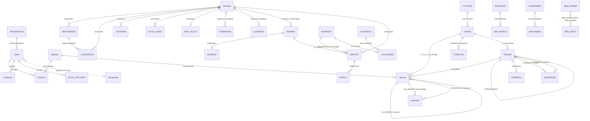

# A5 — Données : les 42 fichiers HFSQL et leurs relations

Inventaire pour la migration HFSQL Classic → PostgreSQL. Aucune donnée client n'a été lue : tout vient de
l'analyse (`lecatalogue.xdd`, Partie 2 du dossier technique p.149-231) et du code WLangage (Parties 1, 3, 5, 6).

## 1. Sources et méthode

| Source | Ce qu'on en tire | Repère |
|---|---|---|
| `Docs/dossier-technique.txt`, Partie 2 « Analyse » | types HFSQL exacts, tailles, libellés, valeurs par défaut, clés composées, taille d'enregistrement | lignes 1669-3398 = p.149-231 ; tableau récapitulatif p.177-179 ; dictionnaire des rubriques p.155-176 ; « Fichiers et rubriques » p.180-230 |
| `lecatalogue.xdd` (export XML de l'analyse, génération n° 149) | nature de chaque clé (`TYPE_CLE` 0 = aucune, 1 = unique, 2 = avec doublons), composantes des clés composées, `FicNullSupporte="0"` sur les 42 fichiers | racine du projet |
| `.claude/docs/modele-donnees.md` | index généré ; ses types « ? » sont levés ici grâce au dossier | — |
| Partie 5 Classes (p.2981-3803) | quelle classe ouvre quel fichier (`Constructeur CEstimeHF("NOM")` / `(NOM..Nom)`), constantes des rubriques « Flags » et « Type » | voir § 4 |
| Partie 1 Projet (p.102-141) | objets globaux `go…`, mot de passe HFSQL `PASS_CLIENT`, dispatch des commandes `Type=` | p.118-141 |
| Partie 4 Requêtes (p.2968-2979) | `ReqAllCatalog`, `ReqListeFils` | § 7 |

Chiffres de l'analyse (p.155) : **42 fichiers, 588 rubriques, 0 liaison déclarée, 0 connexion, 8 groupes**.
Les 576 rubriques listées ci-dessous (§ 8) + 12 entrées « \<Inutilisée\> » du dictionnaire (p.155-176 :
`ADDR_IPNOMMACHINE`, `ADDR_IPSOFTTYPE`, `ADDR_IPTYPEXE`, `BLOCAGE`, `CADENAS`, `Cat_Description`, `Cat_Heure`,
`Cat_P_Heure`, `Cat_P_Temps`…) font les 588. **Aucune liaison (clé étrangère) n'est déclarée dans l'analyse** :
toutes les relations du § 5 sont déduites du code et des noms de rubriques.

Toute la base est en **HFSQL Classic** (fichiers `.FIC` + index `.NDX` + mémos `.MMO`), sans journalisation,
réplication ni sécurité renforcée (colonnes vides du tableau p.177-179 — mais ces colonnes sont des cases à cocher
non reprises dans l'extraction texte, voir § 9). Les fichiers physiques sont dans `LECATALOGUE_WEB/bd/LECATALOGUE/`
(`goConfig:m_sRepBase`, voir A7).

## 2. Vue d'ensemble par domaine

| Domaine | Fichiers | Observations |
|---|---|---|
| **Catalogue web** (site lecatalogue, abonnés « catalogue ») | `Client`, `ClientCat`, `Multicat`, `Itemcat`, `LienAsmb`, `Historique`, `NOTE_CATCLIENT`, `Commande`, `PROVENANCE`, `Banniere2`, `Envoi`, `Version` | `Client` = utilisateurs du site catalogue (login/mot de passe, abonnement). `Multicat` = catalogues, `Itemcat` = sections/items (arbre par `CLE_PARENT`), `LienAsmb` = composition des assemblages |
| **Licences logiciels** (Estimateur Général, e-plans, modules) | `AAClient`, `REPCOMMON`, `LOGVERSION`, `LISTFORM`, `FORMATION`, `INFO_ECOLE`, `NOTE_CLIENT`, `LOGMODIF` | `AAClient` = fiche client/licence administrée par les pages `AA*`. Fichier **protégé par mot de passe HFSQL** (voir § 6) |
| **Unités et métiers** (données « common » partagées avec le logiciel) | `TUNITE`, `TTYPUNIT`, `TTABCONV`, `TRESERVE`, `TRADES`, `TRADESTX`, `EQUIPELEM` | Tables de référence initialisées par le code (`CGroupeUnite::bInit`, p.122-123) ou reçues du logiciel client (`RecupWWWCommon` p.3991) |
| **Salle de plans (SDP)** | `SDPINFO`, `SDPDESC`, `SDPSTAT`, `SDPFIC`, `INTERVEN`, `CACHEDICO`, `CACHEOPER`, `INTRUSION`, `SDP_INTRUS` | Métadonnées des salles (les plans eux-mêmes sont sur disque, voir A7), statistiques d'opérations, intervenants invités |
| **Démo / contrôle d'exécution** | `CLIENTDEMO`, `HISTODEMO`, `IPADDRESS` | Alimentés par les appels HTTP du logiciel (`Type=…`), pas par un usager du site |
| **RBQ** (proxy Régie du bâtiment) | `RBQ_ENTREP`, `RBQ_HISTO` | Quotas et journal des requêtes relayées |
| **Courriels** | `COURRIELS` | Journal des formulaires (café-conférence, contact, commande) |

## 3. Correspondance des types HFSQL → PostgreSQL et pièges

| Type HFSQL (libellé du dossier) | Occurrences | PostgreSQL proposé | Pièges |
|---|---|---|---|
| Identifiant automatique (4 octets) | 28 | `integer GENERATED ALWAYS AS IDENTITY` (ou `serial`) | Conserver les valeurs existantes à l'import (`OVERRIDING SYSTEM VALUE`) puis recaler la séquence : les identifiants sont référencés en clair dans les URL, les fichiers d'export (`AAUserC`), les répertoires SDP (`sSDPGener(nIdClient,…)` p.3527) |
| Chaîne (N) | 203 | `varchar(N)` (ou `text`) | Encodage **Windows-1252** (ANSI) à convertir en UTF-8 ; HFSQL Classic ne stocke pas NULL (`FicNullSupporte="0"`) → chaîne vide. Option « complétion par des espaces » non vérifiable dans l'extraction (§ 9) : appliquer `rtrim` à l'import de toute façon. Le code fait souvent `SansEspace()` à la lecture (p.1413, p.3019) |
| Mémo texte | 14 | `text` | Stocké dans le `.MMO` ; contient des textes libres multi-lignes (RC = CR+LF), parfois des listes séparées par TAB/`|` (`SDPFIC.SDPNOMFIC` p.3598 : séparateur remplacé par TAB à la lecture ; `SDPDESC.SDP_REQ` : requête **chiffrée** par le code appelant, cf. `sCryptReq` p.3530) |
| Booléen | 64 | `boolean` | Stocké sur 1 octet (0/1) ; l'index le qualifie « Booléen » mais certaines pages le testent comme entier |
| Entier sur 4 octets | 90 | `integer` | Beaucoup de « Flags » = champs de bits (constantes § 4) → à éclater en colonnes booléennes ou garder `integer` + documenter |
| Entier non signé sur 4 octets | 15 | `bigint` (ou `integer` + CHECK ≥ 0) | `ITCLEUNIK`, `CleTable`, `IDTRADPARENT`, `IDPARENT`, `SDPADDRIP`, `Flags` de plusieurs fichiers ; `RBQ_ADDRIP`/`ADDRIP`/`SDPADDRIP` = IPv4 encodée en entier (le doublon `*_S` chaîne 40 contient la forme texte IPv4/IPv6) |
| Entier sur 2 octets / non signé sur 2 octets | 4 / 28 | `smallint` / `integer` | `TYPEITEM`, `CAT_NIVEAU`, `TypeCatalog`, `NoLigne`, `LANGUE`, `CLETYPUNIT`… (le `.xdd` les code « Caractère ? » dans l'index généré : ce sont bien des entiers 2 octets, p.183, 226, 228) |
| Entier sur 8 octets / non signé 8 | 3 / 2 | `bigint` / `numeric(20)` | Tailles de fichiers (`SDP_SIZE`, `SDPSIZEFIC`, `SDP_CURSIZE`, `SIZE8`) |
| Entier non signé sur 1 octet | 2 | `smallint` | `SDPLANGC`, `NUMLOGICIEL` |
| Monétaire | 17 | `numeric(24,6)` | Précision HFSQL : 17 entiers + 6 décimales. Ne pas passer par `double` |
| Réel sur 8 octets | 36 | `double precision` | Quantités, ratios, poids, volumes, temps |
| Réel sur 4 octets | 2 | `real` | `NBHFORM` (Client, AAClient) — l'index généré le marque « Entier s.s. 4 ? » : c'est un réel 4 (p.182, 187) |
| Date (aaaammjj) | 36 | `date` | Stockée comme chaîne `AAAAMMJJ` ; **vide ou `00000000` = pas de date → NULL**. Valeur par défaut bizarre `0,000000` sur `Client.DateAchat` (p.186). Le code manipule les dates en chaînes (`DateSys()`, `sGetDateFin`) |
| Heure (hhmm) | 3 | `time` | `HEURE_MODIF`, `LOG_HEURE`, `SDPHEURE` : 4 caractères `HHMM` ; le code y écrit parfois `HeureSys()` complet (p.3597, 3718) → tronqué par HFSQL. Vérifier la perte de secondes |
| Chaîne (14) / (17) « TimeStamp » | ~20 | `timestamp` | Horodatage texte `AAAAMMJJHHMMSSCCC` (17 : `DateSys()+HeureSys()`, p.3032, 3144) ou `AAAAMMJJHHMMSS` (14 : `TIMESTAMP_AJOUT/MODIF` de TRADES/TRADESTX/EQUIPELEM). Convertir en `timestamp` à l'import ; attention aux valeurs vides |
| Chaîne (8) `RBQ_DATE` + Chaîne (6) `RBQ_HEURE` | 2 | `date` + `time` ou un `timestamp` | Date/heure stockées en texte et non en type Date (p.214, `SetHeure` tronque à 6 car. p.3365) |
| Rubriques `…Maj`, `…MAJUS`, `NOMCATMAJ`, `AbrevMaj`, `Cat_CODEG/CODED`, `Cat_DescMaj_*` | ~12 | colonne générée ou index `upper(unaccent(...))` | Clés de recherche normalisées **calculées par le code** : `Majuscule(CUTILS::sSansAccent(x))` (p.3022-3023, 3064, 3013). En PostgreSQL : index d'expression avec `unaccent`/`upper`, ou colonne générée — ne pas migrer tel quel sans recalculer |

Autres pièges transverses :
- **Pas de NULL** nulle part (`FicNullSupporte="0"` sur chaque `<FICHIER>` du `.xdd`) : 0, `""`, `00000000` jouent le rôle de NULL. Décider colonne par colonne (dates surtout).
- **Clés uniques sur chaînes** (`Client.Login`, `AAClient.Nom`, `AAClient.Login`, `Multicat.NOMCATMAJ`, `PROVENANCE.AbrevMaj`, `IPADDRESS.IPADDR`, `INTRUSION.ADRESSE_IP`, `CACHEDICO.CLEPLAN`, `SDPINFO.NUM_SALLE`) : HFSQL compare sans tenir compte de la casse selon les options de la clé (non visible dans l'extraction) ; le code normalise lui-même (`LoginMaj`). Prévoir `citext` ou index `lower()`.
- **Mot de passe** : voir § 6.
- **Entiers « Flags »** : bits documentés § 4 ; `AAClient.Opt*` (booléens) et `OPT_*` (bits dans `REPCOMMON.OPTIONESTIME`, p.118-119 du projet) décrivent la même chose sous deux formes.
- **Doublons de rubriques** entre `Client` et `AAClient` (Nom, Courriel 1-3, Login, mot de passe, DateFinAbonnement, Abonnement, WebMaster, Telephone, NBHFORM) : ce sont deux populations différentes (abonnés du catalogue web vs titulaires de licences), pas une redondance à fusionner aveuglément.

## 4. Classes ↔ fichiers ↔ objets globaux

Toutes les classes d'accès héritent de `CEstimeHF` (p.3148-3176) qui hérite de `CBasicHF` (p.3177-3217). Le fichier est
fixé par `Constructeur CEstimeHF("NOM")` ; `bSetAlias(bAlias, sRep, sPasse)` (p.3158) fait `HChangeRep` + `HCréationSiInexistant(nom[, mot de passe])` (p.3202), et en mode alias ouvre une copie logique `"D"+NOM` (`sConstruitAlias` p.3170 ; utilisé par `DispatchSDPStat` p.3898 et `ReductionLogVersion` p.4001 pour écrire dans un autre répertoire). Les objets globaux sont déclarés dans le code projet p.122 (lignes 651-688).

| Fichier | Classe (déclaration) | Objet global | Pages d'utilisation (dossier) | Rôle déduit |
|---|---|---|---|---|
| AAClient | `CAAClient` p.3394 (agrège `CCommon`, `CListForm`) | `goAAClient` | p.128-141 (projet), 1411-1424 (AADownload), 1562-1617 (AATableClient), 1721, 1947-2036 (SDP), 2124-2144, 2285-2332, 2457, 2504-2907 (AAFicheClient2), 3821-4069 (procédures) | Fiche client **licences** : versions EG/e-plans/modules, options, SDP autorisée, dates de fin, montants de renouvellement |
| Banniere2 | `CBanniere2` p.3507 | `goBanniere2` | p.1681-1682 (GestBan2), 3910 | Bannières partenaires (nom, image, URL, pourcentage d'affichage) |
| CACHEDICO | `CCacheDico` p.3690 | `goCacheDico` | p.3826-3841, 3975 (RecupDico, DispatchSDPStat…) | Dictionnaire des noms de plans téléchargés (dédoublonnage, compteur d'usage) |
| CACHEOPER | `CCacheOper` p.3696 | `goCacheOper` | p.3835-3841 | Cache des opérations SDP par intervenant/plan pour les statistiques |
| Client | `CClient` p.3017 | `goClient` | p.136-141, 283-285 (Oubli), 358, 412-415 (Conditions), 467, 574-584 (ProfilClient2), 649, 826-827 (Catalogue), 932, 952-953, 1019-1023 (Accueil), 1067, 1123, 1232-1242 (TableClient), 1289, 1371-1374, 1593, 1795, 1850-1851, 2016, 2094, 2427-2428, 3847-3995 | Utilisateur du **catalogue web** (login, mot de passe, abonnement, provenance) |
| ClientCat | `CClientCat` p.3219 | `goClientCat` | p.137-141, 574-584, 838, 1238, 2435, 3848-3852, 3882, 3990-3995 | Catalogues autorisés par client (N-N Client ↔ Multicat) |
| CLIENTDEMO | `CClientDemo` p.3767 | `goClientDemo` | p.2943-2952 (PAGE_CLIENTDEMO), 3843-3844, 3995-3999 | Postes en version démo identifiés par IP + type de logiciel |
| Commande | `CCommande` p.3063 | `goCommande` | p.931-935 (Commander), 3910 | Bons de commande saisis sur le site |
| COURRIELS | `CCourriels` p.3713 | `goCourriels` | p.4062-4064 (TraiteConference…) | Journal des formulaires (types : `CAFE_CONFERENCE=1`, `CONTACT_ESTIME=2`, `Commander=3`) |
| Envoi | `CEnvoi` p.3509 | `goEnvoi` | p.1721-1722 (ParamSMTP), 2457-2459 (AARenouvelle), 3910 | Gabarit du courriel (en-tête mémo `Haut`, 4 lignes, pied `bas`) — fichier à 1 enregistrement |
| EQUIPELEM | `CEquipElem` p.3646 (membre de `CTrades`) | via `goTrades:m_pEquipElem` | p.137-141, 3262-3347, 3862-3868, 3910 | Membres d'une équipe (métier parent `IDPARENT` → TRADES) |
| FORMATION | aucune classe trouvée | — | **aucune référence dans le code** (le `TAB_FORMATION` d'AAFicheClient2 p.2830 est lié à `LISTFORM`) | Présent dans l'analyse, inutilisé |
| HISTODEMO | `CHistoDemo` p.3795 | `goHistoDemo` | p.2943-2965 (PAGE_HISTODEMO), 3995-3999 | Historique des lancements en démo (`SOFT_NO=0`, `SOFT_EPLANS=1`, `SOFT_EG=2`) |
| Historique | `CHistorique` p.3144 | `goHistorique` | p.136-141, 931-954, 1373-1374, 3849-3995 | Journal d'actions du catalogue web (constantes `HST_*` p.3144 : connexion, import, export, bon de commande, mauvais mot de passe…) ; `NomTable` reçoit des libellés (`"IMPORT"`, `"EXPORT"`, `"LISTE"`, `"CLIENT"`, `"BONCOMMPDF"`, nom de table Commande) |
| INFO_ECOLE | `CInfoEcole` p.3718 | `goInfoEcole` | p.2498-2502 (AAInfoEcole), 3821, 3884, 3990-3995 | Coordonnées d'établissement scolaire d'un AAClient `B_ECOLE` |
| INTERVEN | `CInterven` p.3593 | `goInterven` | p.1948-1956 (PAGE_PROJET), 3831-3841, 3890, 3910, 3985-3988 | Intervenants (sous-traitants) invités d'une salle de plans ; `ITCLEUNIK` **n'est pas auto** : attribué par le logiciel client / `nSearchITCleUnik` p.3965 |
| INTRUSION | `CIntrusion` p.3782 | `goIntrusion` | p.122, 1575, 2146, 3910, 3933 (`isIntrus`) | IP ayant tenté d'ouvrir une SDP inexistante (> 3 tentatives = intrus) |
| IPADDRESS | `CIPAddress` p.3791 | `goIPAddress` | p.122, 130, 3910 | Liste d'IP à exclure des statistiques (`EXCLURE`) + géolocalisation |
| Itemcat | `CCatalog` p.3249 (membre `CLienAsmb`) | `goCatalog` | p.137-141, 725, 832-840 (Catalogue), 2432-2437, 3252-3341, 3862-3868, 3909-3910 | Items et sections d'un catalogue (arbre `CLE_PARENT`, niveaux `CAT_NIVEAU` : `NIV_ITEM=0`, `NIV_SOUSSECT3=8`, `NIV_SOUSSECT2=9`, `NIV_SOUSSECTION=10`, `NIV_SECTION=20` p.3249) |
| LienAsmb | `CLienAsmb` p.2994 | via `goCatalog:m_pAssemblage` | p.3280, 2994-2996 | Lignes composant un assemblage (`CLE_PARENT` = item assemblage, `IMCLEUNIK` = item composant) |
| LISTFORM | `CListForm` p.3633 | `goListForm` | p.2830, 2874 (AAFicheClient2) | Liste des personnes formées (lignes) d'un AAClient |
| LOGMODIF | aucune classe | — | **aucune référence dans le code** | Présent dans l'analyse, inutilisé |
| LOGVERSION | `CLogVersion` p.3707 | `goLogVersion` | p.130, 3910-3915, 3990-4001 | Journal des connexions des logiciels (`LOG_ESTIME=1`, `LOG_EPLANS=2`, `LOG_MODULE=3`), découpé par mois par `ReductionLogVersion` p.4001 |
| Multicat | `CMultiCat` p.3335 | `goMulticat` | p.137-141, 574-597, 832-841, 1236, 1373, 2429-2438, 3848-3868, 3882, 3910-3912, 3990-3995 | Catalogues (`IMPORT_CAT=0`, `DEFAUT_CAT=1` ; bits `Flags` : `CAT_PRESENCESOUSSECTION=1`, `CAT_DESACTIVEEXEC=2`, `CAT_NIVEAUX=4`, `CAT_NOAFFCODE=8`, `CAT_CADRAGEG=16`) |
| NOTE_CATCLIENT | `CNoteCatClient` p.3637 | `goNoteCatCli` | p.136-141, 575-584, 1373, 3910 | Notes sur un client du catalogue (types `NOTE_AUTRE=0`, `NOTE_FORMATION=1`, `NOTE_COMMENTAIRE=2`, `NOTE_GENERALE=3`, `NOTE_SAUVEGEN=4`) |
| NOTE_CLIENT | `CNoteClient` p.3558 | `goNoteClient` | p.2242-2244 (PAGE_NOTES), 2826-2901 (AAFicheClient2) | Notes sur un client licence (mêmes types) |
| PROVENANCE | `CProvenance` p.2981 | `goProvenance` | p.122-123, 574, 1240, 1306, 3136-3137, 3910 | Associations partenaires (CEGQ, APECQ, ACQ…) ; table **réinitialisée par le code** `bInitTable` p.2981 (contient des coordonnées en dur) ; `Flags` bit `PROV_ACTIF=1` |
| RBQ_ENTREP | `CRBQEntrep` p.2989 | `goRBQEntrep` | p.681-703 (RBQ_ENTREP, RBQ_HISTO pages), 3869-3872, 3910, 4067 | Entreprises utilisant le relais RBQ : quota (`RBQ_LIMITE`, `RBQ_CUMUL`), interdiction |
| RBQ_HISTO | `CRBQHisto` p.3364 | `goRBQHisto` | p.680-683, 2885-2886, 3869-3871, 3910 | Journal des requêtes RBQ relayées |
| REPCOMMON | `CCommon` p.3607 (membre de `CAAClient`) | `goCommon` | p.128, 1593, 2837-2873, 2905-2906, 2943, 3910 | Répertoires « common » déclarés par les postes clients (contrôle de licence : cadenas, nombre de licences, `SRC_EG=0x100000`, `SRC_EP=0x200000`, `MONO_ACHAT=1`, `MONO_LOCAT=2`) |
| SDP_INTRUS | `CSdpIntrus` p.3786 | `goSdpIntrus` | p.122, 2146, 3910, 3933 | Numéros de salle tentés par une IP intruse |
| SDPDESC | `CSDPDesc` p.3530 | `goSDPDesc` | p.2037, 2122-2145, 2329-2335, 3858-3897, 3980, 4012, 4051-4057 | Mot de passe de salle (`SDP_PASS`) et requête (`SDP_REQ`) **chiffrés par l'appelant** (voir § 6) |
| SDPFIC | `CSDPFic` p.3586 | `goSDPFic` (membre de `CSDPStat`) | p.1953-1964, 2125, 3827-3839, 3875-3876, 3894, 3975, 4015 | Fichiers (plans) concernés par une opération SDPSTAT (`FFL_SOURCE=0x10`, `FFL_DEST=0x20`) |
| SDPINFO | `CSDPInfo` p.3514 | `goSDPInfo` | p.133, 1947-1952, 2036-2037, 2094-2095, 2122-2145, 2328-2334, 2826-2830, 3518, 3830-4057 | Salle de plans : client (**AAClient**, vérifié p.3975 `nIdCli=goAAClient:lnClePP()`), dossier, `NUM_SALLE` généré (`sSDPGener` p.3527 : 4 lettres aléatoires + 6 hexa de CRC32), taille, date limite, drapeaux de suppression |
| SDPSTAT | `CSDPStat` p.3536 | `goSDPStat` | p.133, 1951-1964, 2037, 2124-2145, 2329, 3827-4057 | Journal des opérations SDP (`OP_*` 1-20, 100, 101 p.3536) |
| TRADES | `CTrades` p.3051 (agrège `CTradesTx`, `CEquipElem`) | `goTrades` | p.137-141, 3262-3347 (CCatalog), 3862-3868 (bImportCatalogue14…), 3910 | Métiers et équipes (`TYPE_TRADE` métier/équipe ; arbre `IDTRADPARENT`) |
| TRADESTX | `CTradesTx` p.3385 | via `goTrades:m_pTradesTx` | idem TRADES | Historique des taux horaires d'un métier (`TAUX_DATE`, `INV_NUMJOUR` = jour inversé pour tri décroissant, `MARQUE_DEL`) |
| TRESERVE | `CTReserve` p.3011 (membre de `CGroupeUnite` p.3226) | `goGroupeUnite` | p.122-123 | Mots réservés des formules (FR/GB), **initialisés par le code** |
| TTABCONV | `CTTabConv` p.3222 (membre de `CTUnite`) | `goGroupeUnite` | p.122-123 | Facteurs de conversion entre unités |
| TTYPUNIT | `CTTypeUnite` p.3000 | `goGroupeUnite` | p.122-123 | Types d'unités (libellés FR/GB) |
| TUNITE | `CTUnite` p.3320 | `goGroupeUnite` | p.122-123, 3226 | Unités (poids, volume, temps…), métrique/impérial |
| Version | `CVersion` p.3502 | `goVersion` | p.139-140, 1411-1421 (AADownload), 1721, 2457, 3895, 3910-3914, 3990-3995 | Versions courantes des logiciels (1 enregistrement ; indices `IND_EPLANS=1 … IND_MODULE14=6`) |

Valeurs de `AAClient.TypeVersion` : les constantes `VERSION_OR=1, ARGENTPLUS=2, ARGENT=3, BRONZE=4, INVITE=5, EPLANS=6` sont déclarées dans `CAAClient` (p.3394) **mais** l'affichage dans AAFicheClient2 (p.2864) et `CreationListeClient` (p.3881) décode `0=Non enregistrée, 1=Bronze, 2=Argent, 3=Or, 7=Invitation, 10=Argent+` : deux codifications coexistent — à trancher avec l'utilisateur avant migration.

`AAClient.Flags` (p.3395) : `FL_MANUELESTIM=1`, `FL_FACTURATION=2`, `FL_MANUELSDP=4`, `FL_FORCELIC=8`, `FL_DELETE=16` (fiche supprimée logiquement — **les fiches « supprimées » restent dans le fichier**).
`Client.Flags` (p.3017) : `FL_CONDITION=1` (conditions acceptées), `FL_WEBMASTER=2`, `FL_CRYPTE=4` (mot de passe chiffré), `FL_BONCOMMAND=8` (prospect ayant envoyé un bon de commande).
`Itemcat.Flags` : `FLC_WWW=1` (item mis à jour via le web, p.3249). `INTERVEN.FLAGS` : `FL_EG=1` (réponse venue de l'Estimateur Général, p.3593). `INTERVEN.IT_REPONSE` : `REP_ADETERMINER=0, REP_OUI=1, REP_NON=2, REP_PEUTETRE=3`.

## 5. Relations (clés étrangères implicites)

Aucune contrainte n'existe dans HFSQL ; l'intégrité est assurée (ou non) par le code. Liste des liens déduits :

| Fichier.rubrique | → Cible | Cardinalité | Preuve |
|---|---|---|---|
| Client.IDPROVENANCE | PROVENANCE.IDPROVENANCE | N-1 | `lnGetProvenance` p.3020 |
| ClientCat.IDClient / ClientCat.MUCLEUNIK | Client / Multicat | N-N (clé unique CLE_CAT4) | `CClientCat` p.3219 |
| Multicat ← Itemcat.MUCLEUNIK | Multicat.MUCLEUNIK | 1-N | clés `CLE_CODEG/CODED` (MUCLEUNIK+CLE_PARENT+code) p.203 |
| Itemcat.CLE_PARENT | Itemcat.IMCLEUNIK (section parente, 0 = racine) | arbre | `ReqListeFils` p.2978, `lnGetCleParent` |
| Itemcat.IDTRADES | TRADES.IDTRADES | N-1 | clé `CLE_MUTRADES` p.203 |
| Itemcat.P_/V_/T_TUCLEUNIK | TUNITE.TUCLEUNIK (unité poids/volume/temps) | N-1 ×3 | `SetClePoids/SetCleTemps/SetCleVolume` p.3170-3171 |
| LienAsmb.CLE_PARENT | Itemcat.IMCLEUNIK (item assemblage) | 1-N | `CLienAsmb::bAjout` p.2994 |
| LienAsmb.IMCLEUNIK | Itemcat.IMCLEUNIK (composant) | N-1 | idem |
| LienAsmb.MUCLEUNIK | Multicat | N-1 | p.204 |
| LienAsmb.IDTRADES, T_/P_/V_TUCLEUNIK | TRADES, TUNITE | N-1 | p.204-205 |
| Historique.IdClient | Client.IDClient (0 = anonyme) | N-1 | `bAjout` p.3144 ; `CleTable` = clé dans la table nommée par `NomTable` |
| NOTE_CATCLIENT.IDClient | Client | N-1 | p.3637 |
| Commande ↔ Client | par (NomMAJ, Courriel) seulement, pas de clé | — | `Cle_Bon` p.190 ; `Client.Flags FL_BONCOMMAND` |
| AAClient.NUMVENDEUR | (pas de table vendeurs) | — | clé avec doublons p.182 ; valeurs non vérifiées |
| REPCOMMON.IDAAClient | AAClient | N-1 | p.215, `CCommon` membre de `CAAClient` |
| LOGVERSION.IDAAClient / IDREPCOMMON | AAClient / REPCOMMON | N-1 | p.208 |
| LISTFORM.IDAAClient, FORMATION.IDAAClient, INFO_ECOLE.IDAAClient (unique → 1-1), NOTE_CLIENT.IDAAClient, LOGMODIF.IDAAClient | AAClient | N-1 (INFO_ECOLE 1-1) | p.194-211 |
| SDPINFO.IDClient | **AAClient**.IDAAClient (malgré le nom) | N-1 | `RecupDirectorySDP` p.3975, `bSauveInfoSalle` p.3872 |
| SDPDESC.IDSDPINFO | SDPINFO (1-1, clé unique) | 1-1 | p.218 |
| SDPSTAT.IDAAClient / IDSDPINFO | AAClient / SDPINFO | N-1 | p.221 |
| SDPSTAT.SDPCLEDOSS | INTERVEN.ITCLEUNIK (clé dossier sous-traitant) | N-1 | `nSearchITCleUnik` p.3966 |
| SDPFIC.IDSDPSTAT | SDPSTAT | N-1 | p.219 |
| CACHEOPER.ITCLEUNIK / IDCACHEDICO | INTERVEN / CACHEDICO | N-1 | p.185 |
| SDP_INTRUS.IDINTRUSION | INTRUSION | N-1 | `isIntrus` p.3933 |
| HISTODEMO.IDCLIENTDEMO | CLIENTDEMO | N-1 | p.195 |
| TRADES.IDTRADPARENT | TRADES (répertoire parent) | arbre | p.223 |
| TRADESTX.IDTRADES | TRADES | 1-N | `CTrades::bSupprimeTout` p.3051 |
| EQUIPELEM.IDPARENT | TRADES (équipe) ; EQUIPELEM.IDTRADES → TRADES (métier membre) ; IDEQUIPMEMB → ? (non vérifié) | N-1 | p.193, `CTrades::bSetAlias` p.3051 |
| TRADES.T_TUCLEUNIK, TUNITE.CLETYPUNIT, TTABCONV.TUIDENT1/2 | TUNITE / TTYPUNIT / TUNITE | N-1 | p.223-229 |
| RBQ_HISTO ↔ RBQ_ENTREP | par `RBQ_NOMENTREP` / `RBQ_ADDRIP` (pas de clé) | — | `bRequeteRBQ` p.3869 |

Fichiers isolés (aucun lien) : `Banniere2`, `Envoi`, `Version`, `COURRIELS`, `IPADDRESS`, `TRESERVE`.

## 6. Mots de passe et chiffrement (emplacements seulement)

| Élément | Où | Constat |
|---|---|---|
| **Fichier `AAClient.FIC` protégé par mot de passe HFSQL** | constante `PASS_CLIENT` du code projet (p.118, ligne 481, construite par concaténation) ; passée à `goAAClient:bSetAlias(Faux, goConfig:m_sRepBase, PASS_CLIENT)` (p.133, 141, 1411, 1562, 3826, 3884…) → `HCréationSiInexistant(nom, mot de passe)` (`CBasicHF::CreationSiInexistant` p.3202) | HFSQL chiffre le fichier avec ce mot de passe : **l'export des données d'AAClient devra fournir ce mot de passe à l'outil d'extraction** (WDMap/HExporteXML/HOuvre+HPasse). C'est le **seul** fichier ouvert avec un mot de passe (toutes les autres `bSetAlias` n'ont que 2 arguments ; `CTrades::bSetAlias` propage un `sPasse` mais aucun appelant ne le fournit) |
| `Client.Password` (Chaîne 15) | `CClient::sGetPassword/SetPassword` p.3023-3026 ; indicateur `FL_CRYPTE` dans `Client.Flags`, méthodes `isPassCrypte`/`SetPassCrypte` p.3019-3023 | Le drapeau existe mais **aucun appel à `SetPassCrypte`/`isPassCrypte` n'a été trouvé hors de la classe** : le mot de passe est stocké **en clair** et affiché/envoyé en clair (Panier p.285 ligne 5324 ; ProfilClient2 p.574 ; Oubli p.283-285 ; comparaison directe p.1373, 3881) |
| `AAClient.Mot_de_Passe` (Chaîne 10) | `CAAClient::sGetMotDePasse` p.3448, `SetPassword` p.3434 (écriture brute) | **En clair** dans l'enregistrement (le fichier lui-même est chiffré par le mot de passe HFSQL ci-dessus). Comparé en clair par les contrôles de licence (p.3884, 3889, 3896, 3907-3908, 3977, 3997, 4068-4069) ; affiché dans AADownload p.1413 ; **journalisé en clair dans `LogConnect` en cas d'erreur** (p.3997, ligne 140166) → à supprimer à la migration |
| `SDPDESC.SDP_PASS` / `SDP_REQ` | `CSDPDesc::bSetDesc` p.3530-3531 reçoit `sPass`/`sRequete` déjà chiffrés (`sCryptPass`, `sCryptReq`) | Le chiffrement est fait par l'appelant (procédures SDP, p.3858-3897) avec `sGlobCryptePasse`/`sDecrypteInfo` (voir A8) |
| `sGlobCrypteChaine` / `sGlobCryptePasse` / `sGlobDecryptePasse` | procédures globales p.3811-3813 | Servent au **transport** (paramètres `AAUserC`, `#INF#` p.2871) et au mot de passe SMTP, pas au stockage des rubriques Password |
| Fichier externe `COURRIEL.FIC` | `Desabonne` dans PAGE_UNSUBSCRIBE p.2176 (ligne 74554) | `HDéclareExterne` d'un fichier **hors analyse** (chemin lu dans `[PREPARENVOI] REPBASE` du `.ini`), rubriques `COURRIEL_ADDR`, `COURRIEL_SOCIETE`, `COURRIEL_EXCLUS` : liste de désabonnement partagée avec un outil d'envoi externe (voir A6) |

## 7. Requêtes (Partie 4, p.2968-2979)

| Requête | SQL | Paramètres | Usage |
|---|---|---|---|
| `ReqAllCatalog` (p.2968-2973) | `SELECT 43 rubriques FROM Itemcat WHERE MUCLEUNIK = {glnMUCleUnik} AND TYPEITEM = {gnTypeItem}` (renomme `Cat_Description_fr`→`Cat_Description`, `Cat_DescMaj_FR`→`DESC_MAJ`, `TEMPSPRODH`→`Cat_Temps`, `P_TEMPSPRODH`→`Cat_P_Temps`) | `glnMUCleUnik`, `gnTypeItem` | Déclarée dans la liste des éléments du projet (p.102-109, ligne 83) ; **aucun appel `HExécuteRequête(ReqAllCatalog…)` trouvé dans le code** (seul un `HExécuteRequêteSQL` commenté, répété dans l'en-tête de chaque page). Les pages catalogue parcourent `Itemcat` par les clés `CLE_CODEG/CLE_TYPEG` via `CCatalog` |
| `ReqListeFils` (p.2974-2979) | même SELECT, `WHERE MUCLEUNIK = {glnMUCleUnik} AND CLE_PARENT = {glnCleParent}` | `glnMUCleUnik`, `glnCleParent` | Idem : aucun appel trouvé |
| `ReqCatDel.WDR` | fichier présent à la racine, **absent du dossier technique** (non intégrée au projet) | — | Probablement orpheline |

Ces deux requêtes documentent surtout la **vue « liste des items d'un catalogue »** et « fils d'une section » : à reproduire en SQL PostgreSQL (`WHERE mucleunik = $1 AND cle_parent = $2`).

## 8. Rubriques par fichier (ordre alphabétique de l'analyse)

Type HFSQL = libellé exact du dossier (p.180-230) ; Clé = nature lue dans le `.xdd` ; dernière colonne = proposition PostgreSQL (voir § 3 pour les pièges). Les tailles entre parenthèses sont en caractères ; la taille des clés composées (p.180-230) n'est pas reprise.

#### AAClient  (analyse p.180, enregistrement 1463 octets)

| Rubrique | Libellé (analyse) | Type HFSQL | Clé | PostgreSQL proposé |
|---|---|---|---|---|
| IDAAClient | Identifiant de AAClient | Identifiant automatique (4 octets) | **clé unique** | integer GENERATED ALWAYS AS IDENTITY |
| Nom | Nom | Chaîne (80) | **clé unique** | varchar(80) |
| Contact | Contact | Chaîne (50) |  | varchar(50) |
| Date | Date Inscription | Date (aaaammjj) |  | date (NULL si vide) |
| Courriel | Courriel | Chaîne (60) | clé (doublons) | varchar(60) |
| Login | Login | Chaîne (20) | **clé unique** | varchar(20) |
| Mot_de_Passe | Mot de passe | Chaîne (10) |  | varchar(10) |
| Abonnement | Abonnement aux mises à jour | Booléen |  | boolean |
| DateFinAbonnement | Date de fin abonnement | Date (aaaammjj) |  | date (NULL si vide) |
| EstimeVersion5 | Version Estimateur 5 | Chaîne (20) |  | varchar(20) |
| DateDerniereVisite | DateDerniereVisite | Date (aaaammjj) |  | date (NULL si vide) |
| NombreLicence | NombreLicence | Entier non signé sur 2 octets |  | integer (0..65535) |
| EstimeDateVersion5 | Date Version Estimateur 5 | Date (aaaammjj) |  | date (NULL si vide) |
| EstimeVersion12 | Version Estimateur 12 | Chaîne (20) |  | varchar(20) |
| EstimeDateVersion12 | Date Version Estimateur 12 | Date (aaaammjj) |  | date (NULL si vide) |
| ModuleVersion12 | Version module 12 | Chaîne (20) |  | varchar(20) |
| ModuleDateVersion12 | Date Version Module 12 | Date (aaaammjj) |  | date (NULL si vide) |
| NoEmail | NoEmail | Booléen |  | boolean |
| Courriel2 | Courriel2 | Chaîne (60) |  | varchar(60) |
| Courriel3 | Courriel3 | Chaîne (60) |  | varchar(60) |
| WebMaster | Webmaster | Entier non signé sur 2 octets |  | integer (0..65535) |
| Telephone | Telephone | Chaîne (26) |  | varchar(26) |
| Telephone2 | Telephone2 | Chaîne (26) |  | varchar(26) |
| NoteClient | Note | Chaîne (600) |  | varchar(600) |
| MontantMAJ | Montant mise à jour Estime | Monétaire |  | numeric(24,6) |
| Flags | Flags | Entier sur 4 octets |  | integer |
| OptEcheancier | Option Echeancier | Booléen |  | boolean |
| OptComparatif | Option Comparatif | Booléen |  | boolean |
| OptVentilation | Option Ventilation | Booléen |  | boolean |
| OptRepartition | Option Repartition | Booléen |  | boolean |
| OptInvitation | Option Invitations | Booléen |  | boolean |
| OptCatalogue | Abonnement catalogue | Booléen |  | boolean |
| TypeVersion | Type de version estimateur (or, argent,...) | Entier sur 4 octets |  | integer |
| Version_EPlans | Version e-Plans | Chaîne (20) |  | varchar(20) |
| DateVersionEPlans | DateVersion e-Plans | Date (aaaammjj) |  | date (NULL si vide) |
| SDP_AUTORISE | Autorisation de la salle de plans | Booléen |  | boolean |
| SDP_MAXSIZE | Taille total max en Mo | Entier sur 4 octets |  | integer |
| SDP_MAXTIME | Temps max par défaut pour une salle | Entier sur 4 octets |  | integer |
| NUM_FICHE | Numéro de fiche client | Chaîne (10) | clé (doublons) | varchar(10) |
| TypeVersionEPlans | Type de version e-Plans (e-Plans,t-Plans) | Entier sur 4 octets |  | integer |
| DureeVersion | Durée de la version en jours | Entier sur 4 octets |  | integer |
| DateActivation | Date d'activation de la version | Date (aaaammjj) |  | date (NULL si vide) |
| SDP_CURSIZE | Taille totale utilisée | Entier sur 8 octets |  | bigint |
| OptEPlans | Option e-Plans | Booléen |  | boolean |
| OptTPlans | Option t-Plans | Booléen |  | boolean |
| MotCles | Liste de mots clé de recherche | Chaîne (50) |  | varchar(50) |
| MontantSDP | Montant manuel SDP | Monétaire |  | numeric(24,6) |
| RBQInterdit | Interdire RBQ | Booléen |  | boolean |
| AutoriseTuto | Autorisation du tutoriel | Booléen |  | boolean |
| LASTMODIF | Date Heure dernère modif | Chaîne (17) |  | varchar(17) |
| NUMVENDEUR | Identificateur vendeur | Entier sur 4 octets | clé (doublons) | integer |
| DateFinEG | Date de fin de l'Estimateur général | Date (aaaammjj) |  | date (NULL si vide) |
| DateFinEPlans | Date de fin de e-Plans | Date (aaaammjj) |  | date (NULL si vide) |
| IGNORECOMMON | Priorité à l'adresse IP pour les contrôles | Booléen |  | boolean |
| NBLICEPLANS | Nombre de licences e-Plans | Entier non signé sur 2 octets |  | integer (0..65535) |
| EPLANSMONOPOSTE | Vrai si e-Plans monoposte, sinon multiposte | Booléen |  | boolean |
| AUTHIPMULTI | Autorisation de plusieurs adresses IP | Booléen |  | boolean |
| FILTREIP | Filtre sur le début adresse IP | Chaîne (15) |  | varchar(15) |
| VERSION14 | Indique si Estimateur Général Version 14 Booléen | 0 |  | ? |
| EstimeVersion14 | Version Estimateur 14 | Chaîne (20) |  | varchar(20) |
| EstimeDateVersion14 | Date Version Estimateur 14 | Date (aaaammjj) |  | date (NULL si vide) |
| ModuleVersion14 | Version Module 14 | Chaîne (20) |  | varchar(20) |
| ModuleDateVersion14 | Date Version Module 14 | Date (aaaammjj) |  | date (NULL si vide) |
| LOCATION1 | Indique location E.G. | Booléen |  | boolean |
| LOCATION2 | En prévision d'une autre location | Booléen |  | boolean |
| B_ECOLE | Indique si école | Booléen |  | boolean |
| B_MIGREVERSION | Migration des versions effectuée | Booléen |  | boolean |
| EGACHAT | Licences Estimateur Achat | Entier non signé sur 2 octets |  | integer (0..65535) |
| EGLOCAT | Licences Estimateur Location | Entier non signé sur 2 octets |  | integer (0..65535) |
| EPLMONOACHAT | Licences e-Plans monoposte achat | Entier non signé sur 2 octets |  | integer (0..65535) |
| EPLMULTIACHAT | Licences e-Plans multiposte achat | Entier non signé sur 2 octets |  | integer (0..65535) |
| EPLMONOLOCAT | Licences e-Plans monoposte location | Entier non signé sur 2 octets |  | integer (0..65535) |
| EPLMULTILOCAT | Licences e-Plans multiposte location | Entier non signé sur 2 octets |  | integer (0..65535) |
| AJUSTEMENT | Ajustement du total | Monétaire |  | numeric(24,6) |
| NBHFORM | Nombre heures formation | Réel sur 4 octets |  | real |

#### Banniere2  (analyse p.183, enregistrement 330 octets)

| Rubrique | Libellé (analyse) | Type HFSQL | Clé | PostgreSQL proposé |
|---|---|---|---|---|
| IDBanniere2 | Identifiant de Banniere | Identifiant automatique (4 octets) | **clé unique** | integer GENERATED ALWAYS AS IDENTITY |
| Nom | Nom | Chaîne (60) | clé (doublons) | varchar(60) |
| image | Image | Chaîne (50) |  | varchar(50) |
| LienURL | LienURL | Chaîne (200) |  | varchar(200) |
| Pourcentage | Pourcentage | Entier sur 2 octets |  | smallint |
| Flash2 | Flash2 | Entier sur 2 octets |  | smallint |

#### CACHEDICO  (analyse p.184, enregistrement 809 octets)

| Rubrique | Libellé (analyse) | Type HFSQL | Clé | PostgreSQL proposé |
|---|---|---|---|---|
| IDCACHEDICO | Identifiant de CACHEDICO | Identifiant automatique (4 octets) | **clé unique** | integer GENERATED ALWAYS AS IDENTITY |
| NBRUSE | Nombre de téléchargements | Entier sur 4 octets |  | integer |
| NOMPLAN | Nom du plan | Chaîne (260) |  | varchar(260) |
| CLEPLAN | Clé avec nom du plan | Chaîne (520) | **clé unique** | varchar(520) |
| SIZE8 | Taille du plan | Entier non signé sur 8 octets |  | numeric(20) / bigint |
| IDENT_PLAN | Identificateur | Entier non signé sur 2 octets |  | integer (0..65535) |

#### CACHEOPER  (analyse p.185, enregistrement 265 octets)

| Rubrique | Libellé (analyse) | Type HFSQL | Clé | PostgreSQL proposé |
|---|---|---|---|---|
| IDCACHEOPER | Identifiant de CACHEOPER | Identifiant automatique (4 octets) | **clé unique** | integer GENERATED ALWAYS AS IDENTITY |
| TYPE_OPER | Type operateur | Entier sur 4 octets |  | integer |
| TimeStamp | TimeStamp | Chaîne (17) |  | varchar(17) |
| ADDRIP | Adresse IP (IPv4 numerique) | Entier sur 4 octets |  | integer |
| IDCACHEDICO | Identifiant de CACHEDICO | Entier sur 4 octets | clé (doublons) | integer |
| ITCLEUNIK | Clé intervenant | Entier non signé sur 4 octets | clé (doublons) | bigint (ou integer + CHECK) |
| NOM_MAJUS | Nom de la compagnie en majuscules | Chaîne (80) |  | varchar(80) |
| CLE_DOSS | Clé dans dossier | Entier sur 4 octets |  | integer |
| CLE_DEF | Clé dans défauts | Entier sur 4 octets |  | integer |
| LANGC | Langue de correspondance | Entier non signé sur 2 octets |  | integer (0..65535) |
| REPONSE | Reponse | Entier non signé sur 2 octets |  | integer (0..65535) |
| IDENT_PLAN | Identificateur | Entier non signé sur 2 octets | clé (doublons) | integer (0..65535) |
| NOM_CIE | Nom de la compagnie | Chaîne (80) |  | varchar(80) |
| ADDRIP_S | Adresse IP (IPv4 et IPv6) | Chaîne (40) |  | varchar(40) |
| CLE_TRIOPER | NOM_MAJUS + ITCLEUNIK + TYPE_OPER + | clé composée NOM_MAJUS+ITCLEUNIK+TYPE_OPER+IDENT_PLAN | clé (doublons) | index (NOM_MAJUS, ITCLEUNIK, TYPE_OPER, IDENT_PLAN) |

#### Client  (analyse p.186, enregistrement 866 octets)

| Rubrique | Libellé (analyse) | Type HFSQL | Clé | PostgreSQL proposé |
|---|---|---|---|---|
| IDClient | Identifiant de Client | Identifiant automatique (4 octets) | **clé unique** | integer GENERATED ALWAYS AS IDENTITY |
| Nom | Nom | Chaîne (60) | clé (doublons) | varchar(60) |
| Contact | Contact | Chaîne (60) |  | varchar(60) |
| Courriel | Courriel | Chaîne (65) | clé (doublons) | varchar(65) |
| Login | Login | Chaîne (15) | **clé unique** | varchar(15) |
| Password | Mot de pass | Chaîne (15) |  | varchar(15) |
| DateFinAbonnement | DateFin | Date (aaaammjj) |  | date (NULL si vide) |
| DateAchat | DateAchat | Date (aaaammjj) |  | date (NULL si vide) |
| DateDerniereVisite | DateDerniereVisite | Date (aaaammjj) |  | date (NULL si vide) |
| Batch | Batch | Booléen |  | boolean |
| WebMaster | WebMaster | Booléen |  | boolean |
| Abonnement | Abonnement | Booléen |  | boolean |
| Courriel2 | Courriel2 | Chaîne (65) |  | varchar(65) |
| Courriel3 | Courriel3 | Chaîne (65) |  | varchar(65) |
| Telephone | Téléphone | Chaîne (26) |  | varchar(26) |
| Fax1 | Télécopie | Chaîne (26) |  | varchar(26) |
| Sujet | Sujet | Chaîne (50) |  | varchar(50) |
| TexteMemo | TexteMemo | Mémo texte |  | text |
| Flags | Flags | Entier non signé sur 4 octets |  | bigint (ou integer + CHECK) |
| IDPROVENANCE | Identifiant de PROVENANCE | Entier sur 4 octets | clé (doublons) | integer |
| LoginMaj | Login en majuscules | Chaîne (15) | clé (doublons) | varchar(15) |
| NomMaj | Nom en majuscules | Chaîne (60) |  | varchar(60) |
| Adresse | Adresse | Chaîne (100) |  | varchar(100) |
| Ville | Ville | Chaîne (60) |  | varchar(60) |
| Province | Province | Chaîne (50) |  | varchar(50) |
| Pays | Pays | Chaîne (40) |  | varchar(40) |
| CodePostal | CodePostal | Chaîne (10) |  | varchar(10) |
| FacturationAuto | Facturation automatique | Booléen |  | boolean |
| NBHFORM | Nombre heures formation | Réel sur 4 octets |  | real |

#### ClientCat  (analyse p.188, enregistrement 17 octets)

| Rubrique | Libellé (analyse) | Type HFSQL | Clé | PostgreSQL proposé |
|---|---|---|---|---|
| IDClient | Identifiant de Client | Entier sur 4 octets | clé (doublons) | integer |
| MUCLEUNIK | Identifiant de Multicat | Entier sur 4 octets | clé (doublons) | integer |
| CLE_CAT4 | Recherche par client | clé composée IDClient+MUCLEUNIK | **clé unique** | index UNIQUE (IDClient, MUCLEUNIK) |

#### CLIENTDEMO  (analyse p.189, enregistrement 183 octets)

| Rubrique | Libellé (analyse) | Type HFSQL | Clé | PostgreSQL proposé |
|---|---|---|---|---|
| IDCLIENTDEMO | Identifiant de CLIENTDEMO | Identifiant automatique (4 octets) | **clé unique** | integer GENERATED ALWAYS AS IDENTITY |
| ADDR_IP | AdresseIP (IPv4 et IPv6) | Chaîne (40) | clé (doublons) | varchar(40) |
| Courriel | Courriel | Chaîne (60) |  | varchar(60) |
| NBRCONNECT_EG | Nombre de connexions E.G. | Entier sur 4 octets |  | integer |
| VERSION_EG | Version E.G. Ne plus utiliser | Chaîne (10) |  | varchar(10) |
| VERSION | Version | Chaîne (10) |  | varchar(10) |
| FIN_DEMO | Fin demo atteinte | Booléen |  | boolean |
| RESTEJOUR | Nombre de jours restants en local | Entier sur 4 octets |  | integer |
| BLK_DEMO | Blocage de la version DEMO | Booléen |  | boolean |
| NBRCONNECT | Nombre de connexions | Entier sur 4 octets |  | integer |
| DATEDEBUT | Date début | Date (aaaammjj) |  | date (NULL si vide) |
| DATEBUTOIR | Date de fin théorique | Date (aaaammjj) |  | date (NULL si vide) |
| DATELAST | Dernière date dans log | Date (aaaammjj) |  | date (NULL si vide) |
| SOFTTYPE | Type du logiciel | Entier sur 4 octets | clé (doublons) | integer |
| CLE_IPSOFT | ADDR_IP + SOFTTYPE | clé composée ADDR_IP+SOFTTYPE | clé (doublons) | index (ADDR_IP, SOFTTYPE) |

#### Commande  (analyse p.190, enregistrement 686 octets)

| Rubrique | Libellé (analyse) | Type HFSQL | Clé | PostgreSQL proposé |
|---|---|---|---|---|
| IDCommande | Identifiant de Commande | Identifiant automatique (4 octets) | **clé unique** | integer GENERATED ALWAYS AS IDENTITY |
| Nom | Nom | Chaîne (60) | clé (doublons) | varchar(60) |
| Prenom | Prenom | Chaîne (50) |  | varchar(50) |
| NomSociete | NomSociete | Chaîne (60) |  | varchar(60) |
| Fonct | Fonction | Chaîne (50) |  | varchar(50) |
| Adresse | Adresse | Chaîne (100) |  | varchar(100) |
| Ville | Ville | Chaîne (60) |  | varchar(60) |
| Province | Province | Chaîne (50) |  | varchar(50) |
| Pays | Pays | Chaîne (40) |  | varchar(40) |
| CodePostal | CodePostal | Chaîne (10) |  | varchar(10) |
| Telephone | Téléphone | Chaîne (20) |  | varchar(20) |
| Telecopieur | Telecopieur | Chaîne (20) |  | varchar(20) |
| Courriel | Courriel | Chaîne (65) | clé (doublons) | varchar(65) |
| DateBon | DateBon | Date (aaaammjj) |  | date (NULL si vide) |
| Flags | Flags | Entier non signé sur 4 octets |  | bigint (ou integer + CHECK) |
| NomMAJ | Nom en majuscules | Chaîne (60) |  | varchar(60) |
| Cle_Bon | Cle_Bon | clé composée NomMAJ+Courriel | **clé unique** | index UNIQUE (NomMAJ, Courriel) |

#### COURRIELS  (analyse p.191, enregistrement 323 octets)

| Rubrique | Libellé (analyse) | Type HFSQL | Clé | PostgreSQL proposé |
|---|---|---|---|---|
| IDCOURRIELS | Identifiant de COURRIELS | Identifiant automatique (4 octets) | **clé unique** | integer GENERATED ALWAYS AS IDENTITY |
| TYPE_COURRIEL | Type de courriel | Entier non signé sur 2 octets | clé (doublons) | integer (0..65535) |
| NOM_SOCIETE | Nom de la société | Chaîne (100) |  | varchar(100) |
| Courriel | Courriel | Chaîne (60) | clé (doublons) | varchar(60) |
| NOM_CONTACT | Nom du contact | Chaîne (50) |  | varchar(50) |
| PRENOM_CONTACT | Prénom du contact | Chaîne (50) |  | varchar(50) |
| AUTRE_INFO | Autre_info | Mémo texte |  | text |
| TEL_CONTACT | Téléphone contact | Chaîne (16) |  | varchar(16) |
| TimeStamp | TimeStamp | Chaîne (17) | clé (doublons) | varchar(17) |
| Cle_TYPEDATE | TYPE_COURRIEL + TimeStamp | clé composée TYPE_COURRIEL+TimeStamp | clé (doublons) | index (TYPE_COURRIEL, TimeStamp) |

#### Envoi  (analyse p.192, enregistrement 926 octets)

| Rubrique | Libellé (analyse) | Type HFSQL | Clé | PostgreSQL proposé |
|---|---|---|---|---|
| IDEnvoi | Identifiant de Envoi | Identifiant automatique (4 octets) | **clé unique** | integer GENERATED ALWAYS AS IDENTITY |
| Haut | Haut | Mémo texte |  | text |
| ligne1 | Ligne1 | Chaîne (100) |  | varchar(100) |
| ligne2 | Ligne2 | Chaîne (100) |  | varchar(100) |
| ligne3 | Ligne3 | Chaîne (100) |  | varchar(100) |
| ligne4 | Ligne4 | Chaîne (100) |  | varchar(100) |
| bas | Bas | Chaîne (500) |  | varchar(500) |

#### EQUIPELEM  (analyse p.193, enregistrement 192 octets)

| Rubrique | Libellé (analyse) | Type HFSQL | Clé | PostgreSQL proposé |
|---|---|---|---|---|
| IDEQUIPMEMB | Identifiant de EQUIPMEMB | Entier sur 4 octets | clé (doublons) | integer |
| NOLIGNE | No de ligne | Entier sur 2 octets |  | smallint |
| RATIO | Ratio | Réel sur 8 octets |  | double precision |
| IDTRADES | Identifiant de TRADES | Entier sur 4 octets | clé (doublons) | integer |
| FLAGS | Flags | Entier non signé sur 4 octets |  | bigint (ou integer + CHECK) |
| MARQUE_DEL | Marque_del | Booléen |  | boolean |
| IDPARENT | Clé de l'équipe | Entier non signé sur 4 octets | clé (doublons) | bigint (ou integer + CHECK) |
| ELEM_NOM | Nom salarié | Chaîne (80) |  | varchar(80) |
| TYPE_TRADE | Métier ou équipe | Entier non signé sur 2 octets | clé (doublons) | integer (0..65535) |
| INVARIANT | Code invariant | Chaîne (19) | clé (doublons) | varchar(19) |
| USERS | Initiales | Chaîne (20) | clé (doublons) | varchar(20) |
| TIMESTAMP_AJOUT | Timestamp_ajout | Chaîne (14) |  | varchar(14) |
| TIMESTAMP_MODIF | Timestamp_modif | Chaîne (14) |  | varchar(14) |
| CLE_ELEM | IDPARENT+NOLIGNE | clé composée IDPARENT+NOLIGNE | **clé unique** | index UNIQUE (IDPARENT, NOLIGNE) |
| CLE_DELELEM | IDPARENT+MARQUE_DEL | clé composée IDPARENT+MARQUE_DEL | clé (doublons) | index (IDPARENT, MARQUE_DEL) |
| CLE_TYPE | IDPARENT+TYPE_TRADE | clé composée IDPARENT+TYPE_TRADE | clé (doublons) | index (IDPARENT, TYPE_TRADE) |
| CLE_TRADPARENT | IDTRADES+IDPARENT | clé composée IDTRADES+IDPARENT | clé (doublons) | index (IDTRADES, IDPARENT) |

#### FORMATION  (analyse p.194, enregistrement 85 octets)

| Rubrique | Libellé (analyse) | Type HFSQL | Clé | PostgreSQL proposé |
|---|---|---|---|---|
| IDAAClient | Identifiant de AAClient | Entier sur 4 octets | clé (doublons) | integer |
| DATE_FORMATION | Date_formation | Date (aaaammjj) |  | date (NULL si vide) |
| NOTE_FORMATION | Note | Mémo texte |  | text |
| Contact | Contact | Chaîne (50) |  | varchar(50) |
| TEMPS_FORMATION | Temps de la formation en minutes | Entier sur 4 octets |  | integer |
| CLE_CLIFORM | IDAAClient + DATE_FORMATION | clé composée IDAAClient+DATE_FORMATION | clé (doublons) | index (IDAAClient, DATE_FORMATION) |

#### HISTODEMO  (analyse p.195, enregistrement 151 octets)

| Rubrique | Libellé (analyse) | Type HFSQL | Clé | PostgreSQL proposé |
|---|---|---|---|---|
| IDCLIENTDEMO | Identifiant de CLIENDEMO | Entier sur 4 octets | clé (doublons) | integer |
| TimeStamp | TimeStamp | Chaîne (17) | clé (doublons) | varchar(17) |
| TIMESTAMPORDI | TIMESTAMP de l'ordi client | Chaîne (17) |  | varchar(17) |
| IDENTCOMMON | Identificateur common | Chaîne (30) | clé (doublons) | varchar(30) |
| SOFTVERSION | Version du logiciel | Chaîne (10) |  | varchar(10) |
| SOFTTYPE | Type du logiciel | Entier sur 4 octets |  | integer |
| NOMMACHINE | Nom réseau de l'ordinateur | Chaîne (50) |  | varchar(50) |
| RESTEJOUR | Nombre de jours restants en local | Entier sur 4 octets |  | integer |
| CLE_IDTIME | IDCLIENTDEMO + TimeStamp | clé composée IDCLIENTDEMO+TimeStamp | **clé unique** | index UNIQUE (IDCLIENTDEMO, TimeStamp) |

#### Historique  (analyse p.196, enregistrement 100 octets)

| Rubrique | Libellé (analyse) | Type HFSQL | Clé | PostgreSQL proposé |
|---|---|---|---|---|
| IDHistorique | Identifiant de Historique | Identifiant automatique (4 octets) | **clé unique** | integer GENERATED ALWAYS AS IDENTITY |
| NomTable | NomTable | Chaîne (10) | clé (doublons) | varchar(10) |
| CleTable | CleTable | Entier non signé sur 4 octets | clé (doublons) | bigint (ou integer + CHECK) |
| TimeStamp | TimeStamp | Chaîne (17) | clé (doublons) | varchar(17) |
| TypeAction | TypeAction | Entier sur 4 octets |  | integer |
| DescAction | Détail action | Chaîne (40) |  | varchar(40) |
| NoLigne | Numéro de ligne | Entier sur 4 octets |  | integer |
| IdClient | Identifiant de Client | Entier sur 4 octets | clé (doublons) | integer |
| CleHisto | CleHisto | clé composée IdClient+NomTable+CleTable+TimeStamp+NoLigne | **clé unique** | index UNIQUE (IdClient, NomTable, CleTable, TimeStamp, NoLigne) |

#### INFO_ECOLE  (analyse p.197, enregistrement 422 octets)

| Rubrique | Libellé (analyse) | Type HFSQL | Clé | PostgreSQL proposé |
|---|---|---|---|---|
| IDAAClient | Identifiant de AAClient | Entier sur 4 octets | **clé unique** | integer |
| CEGEP_ADRESSE | Adresse | Chaîne (80) |  | varchar(80) |
| CEGEP_VILLE | Ville | Chaîne (60) |  | varchar(60) |
| CEGEP_PROVINCE | Province | Chaîne (30) |  | varchar(30) |
| CEGEP_CODEPOSTAL | Code postal | Chaîne (10) |  | varchar(10) |
| CEGEP_PAYS | Pays | Chaîne (20) |  | varchar(20) |
| CEGEP_TELEPHONE | Téléphone | Chaîne (26) |  | varchar(26) |
| CEGEP_TELECOPIE | Télécopie | Chaîne (26) |  | varchar(26) |
| CEGEP_MOBILE | Téléphone mobile | Chaîne (26) |  | varchar(26) |
| CEGEP_COURRIEL | Courriel | Chaîne (60) |  | varchar(60) |
| CEGEP_SITEWEB | Site web | Chaîne (60) |  | varchar(60) |

#### INTERVEN  (analyse p.198, enregistrement 275 octets)

| Rubrique | Libellé (analyse) | Type HFSQL | Clé | PostgreSQL proposé |
|---|---|---|---|---|
| ITCLEUNIK | Clé intervenant | Entier non signé sur 4 octets | **clé unique** | bigint (ou integer + CHECK) |
| IT_NOMCIE | Nom de la compagnie | Chaîne (80) |  | varchar(80) |
| IT_CODEPOSTAL | Code postal | Chaîne (10) |  | varchar(10) |
| IT_COURRIEL | Courriel | Chaîne (60) |  | varchar(60) |
| IT_TELBUR | Téléphone bureau | Chaîne (20) |  | varchar(20) |
| IT_LANGC | Langue de correspondance | Entier non signé sur 2 octets |  | integer (0..65535) |
| IT_RESPONSABLE | Nom du responsable | Chaîne (60) |  | varchar(60) |
| IT_REPONSE | Réponse invitation | Entier non signé sur 2 octets |  | integer (0..65535) |
| IT_TIMESTAMP | TimeStamp AAAAMMJJHHMMSSCCC | Chaîne (17) |  | varchar(17) |
| FLAGS | Flags | Entier non signé sur 4 octets |  | bigint (ou integer + CHECK) |

#### INTRUSION  (analyse p.199, enregistrement 56 octets)

| Rubrique | Libellé (analyse) | Type HFSQL | Clé | PostgreSQL proposé |
|---|---|---|---|---|
| IDINTRUSION | Identifiant de INTRUSION | Identifiant automatique (4 octets) | **clé unique** | integer GENERATED ALWAYS AS IDENTITY |
| ADRESSE_IP | Adresse IP | Chaîne (20) | **clé unique** | varchar(20) |
| TimeStamp | TimeStamp | Chaîne (17) | clé (doublons) | varchar(17) |
| NBRCONNECT | Nombre de connexions | Entier sur 4 octets |  | integer |

#### IPADDRESS  (analyse p.200, enregistrement 145 octets)

| Rubrique | Libellé (analyse) | Type HFSQL | Clé | PostgreSQL proposé |
|---|---|---|---|---|
| IPADDR | Adresse IP | Chaîne (15) | **clé unique** | varchar(15) |
| EXCLURE | Exclure | Booléen |  | boolean |
| IPPAYS | Pays | Chaîne (40) | clé (doublons) | varchar(40) |
| IPPROVINCE | Province | Chaîne (3) |  | varchar(3) |
| IPVILLE | Ville | Chaîne (50) |  | varchar(50) |
| NBRCONNECT | Nombre de connexions | Entier sur 4 octets |  | integer |
| TimeStamp | TimeStamp | Chaîne (17) | clé (doublons) | varchar(17) |
| ClE_IPEXCLURE | IPADDR + EXCLURE | clé composée IPADDR+EXCLURE | **clé unique** | index UNIQUE (IPADDR, EXCLURE) |

#### Itemcat  (analyse p.201, enregistrement 1101 octets)

| Rubrique | Libellé (analyse) | Type HFSQL | Clé | PostgreSQL proposé |
|---|---|---|---|---|
| IMCLEUNIK | Identifiant de Itemcat | Identifiant automatique (4 octets) | **clé unique** | integer GENERATED ALWAYS AS IDENTITY |
| TYPEITEM | Type d'item associé | Entier non signé sur 2 octets | clé (doublons) | integer (0..65535) |
| Cat_Code | Code | Chaîne (40) | clé (doublons) | varchar(40) |
| Cat_Description_fr | Description | Chaîne (120) |  | varchar(120) |
| Cat_P_Description | P Description | Booléen |  | boolean |
| Cat_MainOeuvre | Main d'oeuvre | Monétaire |  | numeric(24,6) |
| Cat_P_MainOeuvre | P MainOeuvre | Booléen |  | boolean |
| Cat_Unite | Unité | Chaîne (15) |  | varchar(15) |
| Cat_P_Unite | P Unite | Booléen |  | boolean |
| Cat_Cout | Coût | Monétaire |  | numeric(24,6) |
| Cat_P_Cout | P Coût | Booléen |  | boolean |
| Cat_SousTraitant | Sous-traitant | Monétaire |  | numeric(24,6) |
| Cat_P_SousTraitant | P sous-traitant | Booléen |  | boolean |
| Cat_DateRevision | Date de révision | Date (aaaammjj) |  | date (NULL si vide) |
| Cat_Ratio | Ratio | Réel sur 8 octets |  | double precision |
| Cat_P_Ratio | P Ratio | Booléen |  | boolean |
| Cat_Ratio_Pose | Ratio Pose | Booléen |  | boolean |
| Cat_Ratio_Achat | Ratio Achat | Booléen |  | boolean |
| Cat_Carton | Carton | Réel sur 8 octets |  | double precision |
| Cat_P_Carton | P Carton | Booléen |  | boolean |
| Cat_Carton_Pose | Carton Pose | Booléen |  | boolean |
| Cat_Carton_Achat | Carton Achat | Booléen |  | boolean |
| MUCLEUNIK | Identifiant de Multicat | Entier sur 4 octets | clé (doublons) | integer |
| CLE_PARENT | Cle section parent | Entier sur 4 octets | clé (doublons) | integer |
| Cat_Escompte | Escompte | Monétaire |  | numeric(24,6) |
| Cat_P_Escompte | P Escompte | Booléen |  | boolean |
| Pourcentage | Pourcentage | Booléen |  | boolean |
| Cat_Volume | Volume | Réel sur 8 octets |  | double precision |
| Cat_DescMaj_FR | Cat_DescMaj_FR | Chaîne (120) |  | varchar(120) |
| Cat_DescMaj_EN | Cat_DescMaj_EN | Chaîne (120) |  | varchar(120) |
| Cat_DescMaj_ES | Cat_DescMaj_ES | Chaîne (120) |  | varchar(120) |
| Cat_P_Volume | P Volume | Booléen |  | boolean |
| Cat_Poids | Poids | Réel sur 8 octets |  | double precision |
| Cat_P_Poids | P Poids | Booléen |  | boolean |
| P_TUCLEUNIK | Unité de poids | Entier sur 4 octets |  | integer |
| V_TUCLEUNIK | Unité de volume | Entier sur 4 octets |  | integer |
| TEMPSPRODH | Temps de pose | Réel sur 8 octets |  | double precision |
| P_TEMPSPRODH | P Temps | Booléen |  | boolean |
| T_TUCLEUNIK | Unité de temps | Entier sur 4 octets |  | integer |
| DATECRE | Date de création | Date (aaaammjj) |  | date (NULL si vide) |
| DATEMOD | Date de modification | Date (aaaammjj) |  | date (NULL si vide) |
| NBRELEM | Nombre d'éléments | Entier sur 4 octets |  | integer |
| Cat_CODEG | Code majuscule gauche | Chaîne (40) |  | varchar(40) |
| Cat_CODED | Code majuscule droite | Chaîne (40) |  | varchar(40) |
| Flags | Flags | Entier non signé sur 4 octets |  | bigint (ou integer + CHECK) |
| Cat_Description_en | Description en Anglais | Chaîne (120) |  | varchar(120) |
| Cat_Description_es | Description en Espagnol | Chaîne (120) |  | varchar(120) |
| Cat_Equipement | Cat_Equipement | Monétaire |  | numeric(24,6) |
| Cat_Ratio_Equip | Cat_Ratio_Equip | Booléen |  | boolean |
| Cat_Carton_Equip | Cat_Carton_Equip | Booléen |  | boolean |
| Cat_P_Equipement | Cat_P_Equipement | Booléen |  | boolean |
| Cat_Ratio_SousT | Cat_Ratio_SousT | Booléen |  | boolean |
| Cat_Carton_SousT | Cat_Carton_SousT | Booléen |  | boolean |
| FLAGMODECALC | Indique si prix unitaire ou total | Entier sur 4 octets |  | integer |
| DDN2007 | DDN2007 | Chaîne (12) |  | varchar(12) |
| IDTRADES | Identifiant de TRADES | Entier sur 4 octets | clé (doublons) | integer |
| Cat_MontantDivers | Cat_MontantDivers | Monétaire |  | numeric(24,6) |
| Cat_P_MontantDivers | Cat_P_MontantDivers | Booléen |  | boolean |
| PROTECT | Protections | Entier sur 4 octets |  | integer |
| MO_NBRUNIT | Nombre unités production | Réel sur 8 octets |  | double precision |
| CAT_NIVEAU | Niveau de l'item | Entier non signé sur 2 octets | clé (doublons) | integer (0..65535) |
| P_IDTRADES | Protection métier | Booléen |  | boolean |
| CLE_TYPEG | MUCLEUNIK+TYPEITEM+CAT_CODEG | clé composée MUCLEUNIK+CAT_NIVEAU+Cat_CODEG | clé (doublons) | index (MUCLEUNIK, CAT_NIVEAU, Cat_CODEG) |
| CLE_TYPED | MUCLEUNIK+TYPEITEM+CAT_CODED | clé composée MUCLEUNIK+CAT_NIVEAU+Cat_CODED | clé (doublons) | index (MUCLEUNIK, CAT_NIVEAU, Cat_CODED) |
| CLE_CODEG | MUCLEUNIK+CLE_PARENT_CAT_CODEG | clé composée MUCLEUNIK+CLE_PARENT+Cat_CODEG | **clé unique** | index UNIQUE (MUCLEUNIK, CLE_PARENT, Cat_CODEG) |
| CLE_CODED | MUCLEUNIK+CLE_PARENT+CAT_CODED | clé composée MUCLEUNIK+CLE_PARENT+Cat_CODED | **clé unique** | index UNIQUE (MUCLEUNIK, CLE_PARENT, Cat_CODED) |
| CLE_MUTRADES | MUCLEUNIK+IDTRADES | clé composée MUCLEUNIK+IDTRADES | clé (doublons) | index (MUCLEUNIK, IDTRADES) |

#### LienAsmb  (analyse p.204, enregistrement 233 octets)

| Rubrique | Libellé (analyse) | Type HFSQL | Clé | PostgreSQL proposé |
|---|---|---|---|---|
| LACLEUNIK | Identifiant de LienAsmb | Identifiant automatique (4 octets) | **clé unique** | integer GENERATED ALWAYS AS IDENTITY |
| CLE_PARENT | Cle section parent | Entier sur 4 octets | clé (doublons) | integer |
| MUCLEUNIK | Identifiant de Multicat | Entier sur 4 octets | clé (doublons) | integer |
| IMCLEUNIK | Identifiant de Itemcat | Entier sur 4 octets | clé (doublons) | integer |
| QUANTASS | Quantité dans assemblage | Réel sur 8 octets |  | double precision |
| NoLigne | Numéro de ligne | Entier non signé sur 2 octets |  | integer (0..65535) |
| Cat_Unite | Unité | Chaîne (15) |  | varchar(15) |
| Cat_MainOeuvre | Main d'oeuvre | Monétaire |  | numeric(24,6) |
| Cat_Cout | Coût | Monétaire |  | numeric(24,6) |
| Cat_SousTraitant | Sous-traitant | Monétaire |  | numeric(24,6) |
| TEMPSPRODH | Temps de production en heures | Réel sur 8 octets |  | double precision |
| T_TUCleUnik | Unité de temps | Entier sur 4 octets |  | integer |
| PROTECT | PROTECT | Entier sur 4 octets |  | integer |
| FLAGS | Flags | Entier non signé sur 4 octets |  | bigint (ou integer + CHECK) |
| Cat_Equipement | Cat_Equipement | Monétaire |  | numeric(24,6) |
| TYPEITEM | Type d'item associé | Entier non signé sur 2 octets | clé (doublons) | integer (0..65535) |
| Cat_MontantDivers | Cat_MontantDivers | Monétaire |  | numeric(24,6) |
| Cat_poids | Poids | Réel sur 8 octets |  | double precision |
| P_TUCLEUNIK | Unité de poids | Entier sur 4 octets |  | integer |
| Cat_Volume | Volume | Réel sur 8 octets |  | double precision |
| V_TUCLEUNIK | Unité de volume | Entier sur 4 octets |  | integer |
| Cat_Ratio | Ratio | Réel sur 8 octets |  | double precision |
| Cat_Carton | Carton | Réel sur 8 octets |  | double precision |
| FLAGMODECALC | Indique si prix unitaire ou total | Entier sur 4 octets |  | integer |
| RATCART | Flags ratio carton | Entier non signé sur 2 octets |  | integer (0..65535) |
| IDTRADES | Identifiant de TRADES | Entier sur 4 octets | clé (doublons) | integer |
| MO_NBRUNIT | Nombre unités production | Réel sur 8 octets |  | double precision |
| CONTENU_CALC | Contenu_calc | Mémo texte |  | text |
| CONTENU_CALCA | Contenu_calca | Mémo texte |  | text |
| CONTENU_CALCP | Contenu_calcp | Mémo texte |  | text |
| CONTENU_CALCE | Contenu_calce | Mémo texte |  | text |
| CONTENU_CALCS | Contenu_calcs | Mémo texte |  | text |
| CONTENU_CALCD | Contenu_calcd | Mémo texte |  | text |
| CLE_LIEN1 | CLE_LIEN1 | clé composée CLE_PARENT+TYPEITEM+NoLigne | clé (doublons) | index (CLE_PARENT, TYPEITEM, NoLigne) |
| CLE_PARENTIMLIG | CLE_PARENT+IMCLEUNIK+NoLigne | clé composée CLE_PARENT+IMCLEUNIK+NoLigne | clé (doublons) | index (CLE_PARENT, IMCLEUNIK, NoLigne) |

#### LISTFORM  (analyse p.206, enregistrement 72 octets)

| Rubrique | Libellé (analyse) | Type HFSQL | Clé | PostgreSQL proposé |
|---|---|---|---|---|
| IDLISTFORM | Identifiant de LISTFORM | Identifiant automatique (4 octets) | **clé unique** | integer GENERATED ALWAYS AS IDENTITY |
| IDAAClient | Identifiant de AAClient | Entier sur 4 octets | clé (doublons) | integer |
| Contact | Contact | Chaîne (50) |  | varchar(50) |
| NoLigne | Numéro de ligne | Entier sur 4 octets |  | integer |
| CLE_TRILIG | IDAAClient + NoLigne | clé composée IDAAClient+NoLigne | clé (doublons) | index (IDAAClient, NoLigne) |

#### LOGMODIF  (analyse p.207, enregistrement 52 octets)

| Rubrique | Libellé (analyse) | Type HFSQL | Clé | PostgreSQL proposé |
|---|---|---|---|---|
| IDAAClient | Identifiant de AAClient | Entier sur 4 octets | clé (doublons) | integer |
| DATE_MODIF | Date de modification | Date (aaaammjj) |  | date (NULL si vide) |
| HEURE_MODIF | Heure de modification | Heure (hhmm, 4) |  | time (HHMM) |
| LOGIN_MODIF | Login du modificateur | Chaîne (20) |  | varchar(20) |
| FLAG_MODIF | Champs modifiés | Entier sur 4 octets |  | integer |
| CLE_MODIFDATE | IDAAClient + DATE_MODIF+HEURE | clé composée IDAAClient+DATE_MODIF+HEURE_MODIF | **clé unique** | index UNIQUE (IDAAClient, DATE_MODIF, HEURE_MODIF) |

#### LOGVERSION  (analyse p.208, enregistrement 138 octets)

| Rubrique | Libellé (analyse) | Type HFSQL | Clé | PostgreSQL proposé |
|---|---|---|---|---|
| IDLOGVERSION | Identifiant de LOGVERSION | Identifiant automatique (4 octets) | **clé unique** | integer GENERATED ALWAYS AS IDENTITY |
| IDAAClient | Identifiant de AAClient | Entier sur 4 octets | clé (doublons) | integer |
| LOG_DATE | Date | Date (aaaammjj) |  | date (NULL si vide) |
| LOG_HEURE | Heure | Heure (hhmm, 4) |  | time (HHMM) |
| ADDR_IP | AdresseIP (IPv4 et IPv6) | Chaîne (40) | clé (doublons) | varchar(40) |
| NOMMACHINE | Nom réseau de l'ordinateur | Chaîne (50) |  | varchar(50) |
| NUMLOGICIEL | 1 EG, 2 e-Plans | Entier non signé sur 1 octet |  | smallint |
| IDREPCOMMON | Identifiant de REPCOMMON | Entier sur 4 octets | clé (doublons) | integer |
| DATESYSCLI | DateSys client | Date (aaaammjj) |  | date (NULL si vide) |
| Cle_TRILOG | IDAAClient + LOG_DATE + LOG_HEURE + | clé composée IDAAClient+LOG_DATE+LOG_HEURE+NOMMACHINE+ADDR_IP | clé (doublons) | index (IDAAClient, LOG_DATE, LOG_HEURE, NOMMACHINE, ADDR_IP) |

#### Multicat  (analyse p.209, enregistrement 962 octets)

| Rubrique | Libellé (analyse) | Type HFSQL | Clé | PostgreSQL proposé |
|---|---|---|---|---|
| MUCLEUNIK | Identifiant de Multicat | Identifiant automatique (4 octets) | **clé unique** | integer GENERATED ALWAYS AS IDENTITY |
| NomCatalog | NomCatalogue | Chaîne (100) |  | varchar(100) |
| TypeCatalog | TypeCatalogue | Entier non signé sur 2 octets | clé (doublons) | integer (0..65535) |
| NomFic | NomFic | Chaîne (260) |  | varchar(260) |
| Flags | Flags | Entier non signé sur 4 octets |  | bigint (ou integer + CHECK) |
| NomExec | NomExec | Chaîne (260) |  | varchar(260) |
| LigneCMD | LigneCMD | Chaîne (200) |  | varchar(200) |
| NUMREV | Numéro de révision | Entier sur 4 octets |  | integer |
| DATEREV | Date de révision | Date (aaaammjj) |  | date (NULL si vide) |
| NBRITEM | Nombre d'items | Entier sur 4 octets |  | integer |
| NOMCATMAJ | NOMCATMAJ | Chaîne (100) | **clé unique** | varchar(100) |

#### NOTE_CATCLIENT  (analyse p.210, enregistrement 76 octets)

| Rubrique | Libellé (analyse) | Type HFSQL | Clé | PostgreSQL proposé |
|---|---|---|---|---|
| IDNOTE_CATCLIENT | Identifiant de NOTE_CATCLIENT | Identifiant automatique (4 octets) | **clé unique** | integer GENERATED ALWAYS AS IDENTITY |
| IDClient | Identifiant de Client | Entier sur 4 octets | clé (doublons) | integer |
| NOTE_DATE | Date note | Date (aaaammjj) |  | date (NULL si vide) |
| NOTE_TYPE | Type de note | Entier non signé sur 2 octets |  | integer (0..65535) |
| NOTE_TEXT | Texte de la note | Mémo texte |  | text |
| TimeStamp | TimeStamp | Chaîne (17) | clé (doublons) | varchar(17) |
| NOTE_LOGIN | Login du createur de la note | Chaîne (20) | clé (doublons) | varchar(20) |
| CLE_CATDATE | IDClient + NOTE_DATE + TimeStamp | clé composée IDClient+NOTE_DATE+TimeStamp | clé (doublons) | index (IDClient, NOTE_DATE, TimeStamp) |
| CLE_CATTYPE | IDClient + NOTE_TYPE | clé composée IDClient+NOTE_TYPE | clé (doublons) | index (IDClient, NOTE_TYPE) |

#### NOTE_CLIENT  (analyse p.211, enregistrement 76 octets)

| Rubrique | Libellé (analyse) | Type HFSQL | Clé | PostgreSQL proposé |
|---|---|---|---|---|
| IDNOTECLIENT | Identifiant de NOTE_CLIENT | Identifiant automatique (4 octets) | **clé unique** | integer GENERATED ALWAYS AS IDENTITY |
| IDAAClient | Identifiant de AAClient | Entier sur 4 octets | clé (doublons) | integer |
| NOTE_DATE | Date note | Date (aaaammjj) |  | date (NULL si vide) |
| NOTE_TEXT | Texte de la note | Mémo texte |  | text |
| NOTE_LOGIN | Login du createur de la note | Chaîne (20) | clé (doublons) | varchar(20) |
| NOTE_TYPE | Type de note | Entier non signé sur 2 octets |  | integer (0..65535) |
| TimeStamp | TimeStamp | Chaîne (17) | clé (doublons) | varchar(17) |
| CLE_CLIDATE | IDAAClient + DATE_NOTE + TS | clé composée IDAAClient+NOTE_DATE+TimeStamp | clé (doublons) | index (IDAAClient, NOTE_DATE, TimeStamp) |
| CLE_CLITYPE | IDAAClient + NOTE_TYPE | clé composée IDAAClient+NOTE_TYPE | clé (doublons) | index (IDAAClient, NOTE_TYPE) |

#### PROVENANCE  (analyse p.212, enregistrement 699 octets)

| Rubrique | Libellé (analyse) | Type HFSQL | Clé | PostgreSQL proposé |
|---|---|---|---|---|
| IDPROVENANCE | Identifiant de PROVENANCE | Identifiant automatique (4 octets) | **clé unique** | integer GENERATED ALWAYS AS IDENTITY |
| Abreviation | Abréviation | Chaîne (15) |  | varchar(15) |
| Description | Description | Chaîne (200) |  | varchar(200) |
| AbrevMaj | Abréviation en majuscule | Chaîne (15) | **clé unique** | varchar(15) |
| Courriel | Courriel | Chaîne (65) | clé (doublons) | varchar(65) |
| Telecopieur | Telecopieur | Chaîne (26) |  | varchar(26) |
| AddrComplete | Adresse complète | Chaîne (300) |  | varchar(300) |
| Telephone | Téléphone | Chaîne (26) |  | varchar(26) |
| TelSansFrais | Téléphone sans frais | Chaîne (26) |  | varchar(26) |
| Flags | Flags | Entier non signé sur 4 octets |  | bigint (ou integer + CHECK) |

#### RBQ_ENTREP  (analyse p.213, enregistrement 188 octets)

| Rubrique | Libellé (analyse) | Type HFSQL | Clé | PostgreSQL proposé |
|---|---|---|---|---|
| IDRBQ_ENTREP | Identifiant de RBQ_ENTREP | Identifiant automatique (4 octets) | **clé unique** | integer GENERATED ALWAYS AS IDENTITY |
| RBQ_NOMENTREP | Nom entreprise | Chaîne (120) | clé (doublons) | varchar(120) |
| RBQ_ADDRIP | Adresse IP (IPv4 numerique) | Entier sur 4 octets | clé (doublons) | integer |
| RBQ_CUMUL | Cumul en cours | Entier sur 4 octets |  | integer |
| RBQ_INTERDIT | Interdire transfert | Booléen |  | boolean |
| RBQ_LIMITE | Limite de transfert | Entier sur 4 octets |  | integer |
| RBQ_ADDRIP_S | Adresse IP (IPv4 et IPv6) | Chaîne (40) | clé (doublons) | varchar(40) |

#### RBQ_HISTO  (analyse p.214, enregistrement 422 octets)

| Rubrique | Libellé (analyse) | Type HFSQL | Clé | PostgreSQL proposé |
|---|---|---|---|---|
| IDRBQ_HISTO | Identifiant de RBQ_HISTO | Identifiant automatique (4 octets) | **clé unique** | integer GENERATED ALWAYS AS IDENTITY |
| RBQ_NOMENTREP | Nom entreprise | Chaîne (120) | clé (doublons) | varchar(120) |
| RBQ_ADDRIP | Adresse IP (IPv4 numerique) | Entier sur 4 octets | clé (doublons) | integer |
| RBQ_CUMUL | Cumul en cours | Entier sur 4 octets |  | integer |
| RBQ_DATE | Date requete | Chaîne (8) | clé (doublons) | varchar(8) |
| RBQ_HEURE | Heure requete | Chaîne (6) |  | varchar(6) |
| RBQ_REQUETE | Texte requete | Chaîne (200) |  | varchar(200) |
| RBQ_VERSION | Version | Chaîne (20) |  | varchar(20) |
| RBQ_ADDRIP_S | Adresse IP (IPv4 et IPv6) | Chaîne (40) | clé (doublons) | varchar(40) |
| CLE_DATE | RBQ_DATE+RBQ_HEURE | clé composée RBQ_DATE+RBQ_HEURE | clé (doublons) | index (RBQ_DATE, RBQ_HEURE) |

#### REPCOMMON  (analyse p.215, enregistrement 576 octets)

| Rubrique | Libellé (analyse) | Type HFSQL | Clé | PostgreSQL proposé |
|---|---|---|---|---|
| IDREPCOMMON | Identifiant de REPCOMMON | Identifiant automatique (4 octets) | **clé unique** | integer GENERATED ALWAYS AS IDENTITY |
| NOM_ENTREP | Nom de l'entreprise | Chaîne (80) |  | varchar(80) |
| LOCKREP | Blocage du répertoire | Booléen |  | boolean |
| REP_COMMON | Répertoire common | Chaîne (300) |  | varchar(300) |
| NBRLICENCE | Nombre de licences | Entier sur 4 octets |  | integer |
| OPTIONESTIME | Options de l'Estimateur Général | Entier sur 4 octets |  | integer |
| TypeVersion | Type de version estimateur | Entier sur 4 octets |  | integer |
| IDAAClient | Identifiant de AAClient | Entier sur 4 octets | clé (doublons) | integer |
| ADDR_IP | AdresseIP (IPv4 et IPv6) | Chaîne (40) | clé (doublons) | varchar(40) |
| DateFinAbonnement | Date de fin de validité pour le répertoire | Date (aaaammjj) |  | date (NULL si vide) |
| DateCreat | Date de creation de l'enregistrement | Date (aaaammjj) |  | date (NULL si vide) |
| NOMMACHINE | Nom réseau de l'ordinateur | Chaîne (50) |  | varchar(50) |
| REP_NETTOYER | Nettoyer les protections | Booléen |  | boolean |
| TimeStamp | TimeStamp | Chaîne (17) | clé (doublons) | varchar(17) |
| RESTEJOUR | Nombre de jours restants | Entier sur 4 octets |  | integer |
| CADENAS_CLI | Etat du cadenas client | Entier sur 2 octets |  | smallint |
| CADENAS_SRV | Etat du cadenas demandé | Entier sur 2 octets |  | smallint |
| INDIC_REP | Indicateur du common | Chaîne (20) |  | varchar(20) |
| ENREG_MONO | Type monoposte (location, achat) | Entier sur 4 octets |  | integer |
| CLE_CLI_IP_ORDI | IDAAClient + ADDR_IP + NOMMACHINE | clé composée IDAAClient+ADDR_IP+NOMMACHINE | clé (doublons) | index (IDAAClient, ADDR_IP, NOMMACHINE) |

#### SDP_INTRUS  (analyse p.217, enregistrement 46 octets)

| Rubrique | Libellé (analyse) | Type HFSQL | Clé | PostgreSQL proposé |
|---|---|---|---|---|
| IDINTRUSION | Identifiant de INTRUSION | Entier sur 4 octets | clé (doublons) | integer |
| NUM_SALLE | Num_salle | Chaîne (10) | clé (doublons) | varchar(10) |
| TimeStamp | TimeStamp | Chaîne (17) | clé (doublons) | varchar(17) |
| NBRCONNECT | Nombre de connexions | Entier sur 4 octets |  | integer |
| CLE_IPSDP | IDINTRUSION + NUM_SALLE | clé composée IDINTRUSION+NUM_SALLE | **clé unique** | index UNIQUE (IDINTRUSION, NUM_SALLE) |

#### SDPDESC  (analyse p.218, enregistrement 52 octets)

| Rubrique | Libellé (analyse) | Type HFSQL | Clé | PostgreSQL proposé |
|---|---|---|---|---|
| IDSDPINFO | Identifiant de SDPINFO | Entier sur 4 octets | **clé unique** | integer |
| SDP_REQ | Requete | Mémo texte |  | text |
| SDP_PASS | pass | Chaîne (30) |  | varchar(30) |

#### SDPFIC  (analyse p.219, enregistrement 47 octets)

| Rubrique | Libellé (analyse) | Type HFSQL | Clé | PostgreSQL proposé |
|---|---|---|---|---|
| IDSDPSTAT | Identifiant de SDPSTAT | Entier sur 4 octets | clé (doublons) | integer |
| SDPSIZEFIC | Taille du fichier | Entier sur 8 octets |  | bigint |
| SDPNOMFIC | Nom du fichier transmis | Mémo texte |  | text |
| Flags | Flags | Entier sur 4 octets |  | integer |
| SDPDATE | Date transmission | Date (aaaammjj) |  | date (NULL si vide) |
| SDPHEURE | Heure transmission | Heure (hhmm, 4) |  | time (HHMM) |
| IDSDPSTATSDPDATESDPHEUR | IDSDPSTAT + SDPDATE + SDPHEURE | clé composée IDSDPSTAT+SDPDATE+SDPHEURE | ? | index (IDSDPSTAT, SDPDATE, SDPHEURE) |

#### SDPINFO  (analyse p.220, enregistrement 113 octets)

| Rubrique | Libellé (analyse) | Type HFSQL | Clé | PostgreSQL proposé |
|---|---|---|---|---|
| IDSDPINFO | Identifiant de SDPINFO | Identifiant automatique (4 octets) | **clé unique** | integer GENERATED ALWAYS AS IDENTITY |
| IDClient | Identifiant de Client | Entier sur 4 octets | clé (doublons) | integer |
| DOSSIER_NOM | Dossier_nom | Chaîne (12) |  | varchar(12) |
| NUM_SALLE | Num_salle | Chaîne (10) | **clé unique** | varchar(10) |
| TIMESTAMP_CREAT | Date et heure creation | Chaîne (17) |  | varchar(17) |
| TIMESTAMP_MODIF | Date et heure modification | Chaîne (17) |  | varchar(17) |
| SDP_DELETED | Indique salle de plans supprimée | Booléen |  | boolean |
| SDP_LANGUE | Langue par défaut | Entier non signé sur 2 octets |  | integer (0..65535) |
| SDP_SIZE | Taille de la salle | Entier sur 8 octets |  | bigint |
| SDP_NBRFIC | Nombre de fichiers | Entier sur 4 octets |  | integer |
| SDP_DATELIMITE | Date limite | Date (aaaammjj) | clé (doublons) | date (NULL si vide) |
| DATE_DELETE | Date suppression de ;a salle | Date (aaaammjj) |  | date (NULL si vide) |
| SDP_DELFIC | Indique plans supprimés | Booléen |  | boolean |
| CLE_CLIDOSS | IDClient + DOSSIER_NOM | clé composée IDClient+DOSSIER_NOM | **clé unique** | index UNIQUE (IDClient, DOSSIER_NOM) |
| ClE_DELTIME | SDP_DELETED + SDP_DATELIMITE | clé composée SDP_DELETED+SDP_DATELIMITE | clé (doublons) | index (SDP_DELETED, SDP_DATELIMITE) |
| ClE_DELFIC | SDP_DELETED + SDP_DELFIC + DATE_DELETE | clé composée SDP_DELETED+SDP_DELFIC+DATE_DELETE | clé (doublons) | index (SDP_DELETED, SDP_DELFIC, DATE_DELETE) |

#### SDPSTAT  (analyse p.221, enregistrement 103 octets)

| Rubrique | Libellé (analyse) | Type HFSQL | Clé | PostgreSQL proposé |
|---|---|---|---|---|
| IDSDPSTAT | Identifiant de SDPSTAT | Identifiant automatique (4 octets) | **clé unique** | integer GENERATED ALWAYS AS IDENTITY |
| IDAAClient | Identifiant de AAClient | Entier sur 4 octets | clé (doublons) | integer |
| IDSDPINFO | Identifiant de SDPINFO | Entier sur 4 octets | clé (doublons) | integer |
| SDPTYPEOP | Type d'opération | Entier non signé sur 2 octets |  | integer (0..65535) |
| SDPTimeStamp | Date et heure opération | Chaîne (17) |  | varchar(17) |
| SDPADDRIP | Adresse IP (IPv4 numerique) | Entier non signé sur 4 octets | clé (doublons) | bigint (ou integer + CHECK) |
| SDPSIZEFIC | Taille du fichier ou somme ou clé défaut Entier sur 8 octets | 0 |  | ? |
| SDPCLEDOSS | Clé dossier soustraitant | Entier sur 4 octets |  | integer |
| SDPLANGC | Langue de correspondance | Entier non signé sur 1 octet |  | smallint |
| FL_DICO | Traitement dictionnaire | Booléen |  | boolean |
| FL_OPER | Traitement operateur | Booléen |  | boolean |
| SDPADDRIP_S | Adresse IP (IPv4 et IPv6) | Chaîne (40) | clé (doublons) | varchar(40) |
| CLE_SDPTRI | IDAAClient + IDSDPINFO + SDPTimeStamp + | clé composée IDAAClient+IDSDPINFO+SDPTimeStamp+SDPTYPEOP+SDPADDRIP | clé (doublons) | index (IDAAClient, IDSDPINFO, SDPTimeStamp, SDPTYPEOP, SDPADDRIP) |
| CLE_SDPTYPEOP | IDAAClient + IDSDPINFO + SDPTYPEOP | clé composée IDAAClient+IDSDPINFO+SDPTYPEOP+SDPTimeStamp | clé (doublons) | index (IDAAClient, IDSDPINFO, SDPTYPEOP, SDPTimeStamp) |
| CLE_SDPTRI2 | IDAAClient + IDSDPINFO + SDPTimeStamp | clé composée IDAAClient+IDSDPINFO+FL_OPER+SDPTimeStamp+SDPTYPEOP+SDPADDRIP | clé (doublons) | index (IDAAClient, IDSDPINFO, FL_OPER, SDPTimeStamp, SDPTYPEOP, SDPADDRIP) |
| CLE_SDPTYPEOP2 | IDAAClient + IDSDPINFO + FL_DICO + | clé composée IDAAClient+IDSDPINFO+FL_DICO+SDPTYPEOP+SDPTimeStamp | clé (doublons) | index (IDAAClient, IDSDPINFO, FL_DICO, SDPTYPEOP, SDPTimeStamp) |

#### TRADES  (analyse p.223, enregistrement 488 octets)

| Rubrique | Libellé (analyse) | Type HFSQL | Clé | PostgreSQL proposé |
|---|---|---|---|---|
| IDTRADES | Identifiant de TRADES | Identifiant automatique (4 octets) | **clé unique** | integer GENERATED ALWAYS AS IDENTITY |
| METIER_CODE | code métier | Chaîne (12) | clé (doublons) | varchar(12) |
| TAUX_VAL | Valeur du taux | Monétaire |  | numeric(24,6) |
| TAUX_UTEMPS | Cle temps | Entier sur 4 octets |  | integer |
| TAUX_DATE | Date | Date (aaaammjj) |  | date (NULL si vide) |
| USERS | Utilisateur | Chaîne (20) | clé (doublons) | varchar(20) |
| METIER_DESC | Description multilangue | Chaîne (300) |  | varchar(300) |
| INVARIANT | Invariant | Chaîne (19) | clé (doublons) | varchar(19) |
| IDTRADPARENT | Id du parent (répertoire) | Entier non signé sur 4 octets | clé (doublons) | bigint (ou integer + CHECK) |
| TYPE_TRADE | Métier ou équipe | Entier non signé sur 2 octets | clé (doublons) | integer (0..65535) |
| TIMESTAMP_AJOUT | Timestamp_ajout | Chaîne (14) |  | varchar(14) |
| TIMESTAMP_MODIF | Timestamp_modif | Chaîne (14) |  | varchar(14) |
| ELEM_EQUIPE | Contient au moins une équipe | Booléen |  | boolean |
| HIDE_TRADE | Métier invisible dans la liste | Booléen |  | boolean |
| Flags | Flags | Entier sur 4 octets |  | integer |
| B_PRODDEF | Production par defaut | Booléen |  | boolean |
| MO_NBRUNIT | Nombre unités production | Réel sur 8 octets |  | double precision |
| CODEUNITE | Code unité associé à la formule | Chaîne (30) | clé (doublons) | varchar(30) |
| TEMPSPRODH | Temps de pose | Réel sur 8 octets |  | double precision |
| T_TUCLEUNIK | Unité de temps | Entier sur 4 octets |  | integer |
| B_FIXEDOSS | Production pour tout le dossier | Booléen |  | boolean |
| CLE_TYPEIDTRADES | TYPE_TRADE + IDTRADES | clé composée TYPE_TRADE+IDTRADES | clé (doublons) | index (TYPE_TRADE, IDTRADES) |

#### TRADESTX  (analyse p.225, enregistrement 93 octets)

| Rubrique | Libellé (analyse) | Type HFSQL | Clé | PostgreSQL proposé |
|---|---|---|---|---|
| IDTRADES | Identifiant de TRADES | Entier sur 4 octets | clé (doublons) | integer |
| TAUX_DATE | Date | Date (aaaammjj) |  | date (NULL si vide) |
| TAUX_VAL | Valeur du taux | Monétaire |  | numeric(24,6) |
| TAUX_UTEMPS | Cle temps | Entier sur 4 octets |  | integer |
| USERS | Utilisateur | Chaîne (20) | clé (doublons) | varchar(20) |
| INV_NUMJOUR | Numéro de jour inversé | Entier sur 4 octets |  | integer |
| TIMESTAMP_AJOUT | Timestamp_ajout | Chaîne (14) |  | varchar(14) |
| TIMESTAMP_MODIF | Timestamp_modif | Chaîne (14) |  | varchar(14) |
| MARQUE_DEL | Marque_del | Booléen |  | boolean |
| CLE_IDDATE | IDTRADES+TAUX_DATE | clé composée IDTRADES+TAUX_DATE | **clé unique** | index UNIQUE (IDTRADES, TAUX_DATE) |
| CLE_IDINVNUM | IDTRADES+INV_NUMJOUR | clé composée IDTRADES+INV_NUMJOUR | **clé unique** | index UNIQUE (IDTRADES, INV_NUMJOUR) |
| CLE_DELTAUX | IDTRADES + MARQUE_DEL | clé composée IDTRADES+MARQUE_DEL | clé (doublons) | index (IDTRADES, MARQUE_DEL) |

#### TRESERVE  (analyse p.226, enregistrement 363 octets)

| Rubrique | Libellé (analyse) | Type HFSQL | Clé | PostgreSQL proposé |
|---|---|---|---|---|
| TRCLEUNIK | Identifiant de TRESERVE | Identifiant automatique (4 octets) | **clé unique** | integer GENERATED ALWAYS AS IDENTITY |
| LANGUE | Langue | Entier sur 2 octets | clé (doublons) | smallint |
| MOTRESERVE | Mot réservé | Chaîne (32) |  | varchar(32) |
| MOTMAJUS | Mot en majuscule | Chaîne (32) | clé (doublons) | varchar(32) |
| SYNTAXE | Syntaxe | Chaîne (80) |  | varchar(80) |
| DESCMOT | Description | Chaîne (200) |  | varchar(200) |
| CLE_MOT | CLE_MOT | clé composée MOTMAJUS+LANGUE | **clé unique** | index UNIQUE (MOTMAJUS, LANGUE) |

#### TTABCONV  (analyse p.227, enregistrement 70 octets)

| Rubrique | Libellé (analyse) | Type HFSQL | Clé | PostgreSQL proposé |
|---|---|---|---|---|
| TUIDENT1 | Unité origine | Entier sur 4 octets | clé (doublons) | integer |
| TUIDENT2 | Unité destination | Entier sur 4 octets | clé (doublons) | integer |
| VALCONV | Valeur conversion | Réel sur 8 octets |  | double precision |
| SVALCONV | Valeur en chaine | Chaîne (40) |  | varchar(40) |
| Flags | Flags | Entier non signé sur 4 octets |  | bigint (ou integer + CHECK) |
| CLE_CONV | CLE_CONV | clé composée TUIDENT1+TUIDENT2 | **clé unique** | index UNIQUE (TUIDENT1, TUIDENT2) |

#### TTYPUNIT  (analyse p.228, enregistrement 73 octets)

| Rubrique | Libellé (analyse) | Type HFSQL | Clé | PostgreSQL proposé |
|---|---|---|---|---|
| CLETYPUNIT | Clé type unité | Entier sur 2 octets | **clé unique** | smallint |
| TTDESCFR | Description Française | Chaîne (30) |  | varchar(30) |
| TTDESCGB | Description Anglaise | Chaîne (30) |  | varchar(30) |

#### TUNITE  (analyse p.229, enregistrement 128 octets)

| Rubrique | Libellé (analyse) | Type HFSQL | Clé | PostgreSQL proposé |
|---|---|---|---|---|
| TUCLEUNIK | Identifiant de TUNITE | Identifiant automatique (4 octets) | **clé unique** | integer GENERATED ALWAYS AS IDENTITY |
| CLETYPUNIT | Clé type unité | Entier sur 2 octets | clé (doublons) | smallint |
| NOMUNITE | Nom unité | Chaîne (16) |  | varchar(16) |
| FRLIBUNIT | Libellé Français | Chaîne (40) |  | varchar(40) |
| GBLIBUNIT | Libellé Anglais | Chaîne (40) |  | varchar(40) |
| METRIMP | Métrique ou Impérial | Chaîne (1) |  | varchar(1) |
| SYMBOLE | Symbole | Chaîne (10) |  | varchar(10) |
| CLE_UTRI | CLE_UTRI | clé composée CLETYPUNIT+METRIMP | clé (doublons) | index (CLETYPUNIT, METRIMP) |

#### Version  (analyse p.230, enregistrement 1778 octets)

| Rubrique | Libellé (analyse) | Type HFSQL | Clé | PostgreSQL proposé |
|---|---|---|---|---|
| IDVersion | Identifiant de Version | Identifiant automatique (4 octets) | **clé unique** | integer GENERATED ALWAYS AS IDENTITY |
| EstimeVersion5 | Versions Estimateur Général 5 | Chaîne (50) |  | varchar(50) |
| EstimeVersion12 | Guide de formation | Chaîne (50) |  | varchar(50) |
| ModuleVersion12 | Estimateur Général Version 12 | Chaîne (50) |  | varchar(50) |
| DescVersion5 | Description Versions 5 | Chaîne (200) |  | varchar(200) |
| DescVersion_Guide | Guide de formation | Chaîne (200) |  | varchar(200) |
| DescVersion_Estime12 | Estimateur General 12 | Chaîne (200) |  | varchar(200) |
| Version_Module12 | Version Module12 | Chaîne (50) |  | varchar(50) |
| DescVersion_Module12 | Description Version Module12 | Chaîne (200) |  | varchar(200) |
| Version_EPlans | Version e-plans | Chaîne (50) |  | varchar(50) |
| DescVersion_EPlan | Description | version e-plans |  | ? |
| EstimeVersion14 | Estimateur Général Version 14 | Chaîne (50) |  | varchar(50) |
| DescVersion_Estime14 | Description de la version Estime14 | Chaîne (200) |  | varchar(200) |
| Version_Module14 | Version module14 | Chaîne (50) |  | varchar(50) |
| DescVersion_Module14 | Description version module14 | Chaîne (200) |  | varchar(200) |

## 9. Fichiers hors analyse / analyse sans usage

| Cas | Détail |
|---|---|
| Présent dans l'analyse, **jamais utilisé par le code** | `FORMATION` (6 rubriques, p.194) et `LOGMODIF` (6 rubriques, p.207) : aucune classe, aucun `..Nom`, aucune chaîne `"FORMATION"`/`"LOGMODIF"` dans les Parties 1, 3, 5, 6. Les heures de formation sont dans `AAClient.NBHFORM` et les personnes formées dans `LISTFORM`. À ne pas migrer (ou migrer vides) |
| Utilisé seulement par initialisation | `PROVENANCE` (`bInitTable` p.2981 recrée les lignes à partir d'une liste en dur avec courriels/téléphones des associations — ne pas recopier), `TRESERVE`/`TTYPUNIT`/`TUNITE`/`TTABCONV` (`CGroupeUnite::bInit` p.123, `bInitTables`) |
| Fichier HFSQL **hors analyse** utilisé par le code | `COURRIEL.FIC` via `HDéclareExterne` (PAGE_UNSUBSCRIBE p.2176) — appartient à l'outil d'envoi externe (`[PREPARENVOI]`) ; `OLD_<table>` via `HDéclareExterne` dans `CEstimeHF::bRecuperer` p.3155 (migration d'anciennes versions de fichiers, code de maintenance) ; alias `D<TABLE>` (`sConstruitAlias` p.3170) pour écrire des copies de `SDPSTAT`/`SDPFIC`/`LOGVERSION` dans d'autres répertoires (p.3898, 4001) |
| Base HFSQL **externe RBQ** | `COMPAGNIE.FIC` dans `LECATALOGUE_WEB/RecupEntrep/` (avec `DICOREF_n`/`DICOLIEN_n`, voir A7 § 4.8) ouverte par `HDéclareExterne` dans `ConstruitReqRBQ` p.3877 (ligne 134991) : base produite par l'outil WinDev `RecupEntrep.exe`, structure non décrite dans l'analyse du site. À inventorier séparément si le relais RBQ est conservé |
| Fichiers HFSQL de catalogue importés | `CMultiCat` (p.3341-3347, lignes 116718 et 116900) déclare par `HDéclareExterne` les `.FIC` extraits d'une archive WDZ d'import v14 (`bImportCatalogue14` p.3862) : ce sont des copies de `Multicat`/`Itemcat`/`LienAsmb` produites par le logiciel client, même structure |
| Fichiers `.FIC` à la racine du projet | `RADFic`, `RADProp`, `RADRub` : fichiers du générateur RAD de WebDev, pas des données applicatives |
| Fichier `Banniere` (sans 2) | n'existe plus ; seule `Banniere2` est dans l'analyse (classe `CBanniere.wdc` à la racine est un reliquat non inclus au dossier) |
| Requête `ReqCatDel.WDR` | à la racine, absente du dossier |

## 10. Volumétrie

- La taille des `.FIC/.NDX/.MMO` dans `LECATALOGUE_WEB/bd/LECATALOGUE/` n'a pas pu être relevée : la commande `ls -l` sur ce dossier a été **refusée par le système de permissions** de la session (deux tentatives). À faire par l'utilisateur : `ls -l LECATALOGUE_WEB/bd/LECATALOGUE/` (tailles seulement).
- Tailles d'enregistrement (analyse p.177-179, reprises dans les en-têtes du § 8) : `AAClient` 1463 o, `Itemcat` 1101 o, `Multicat` 962 o, `Envoi` 926 o, `Client` 866 o, `CACHEDICO` 809 o, `PROVENANCE` 699 o, `Commande` 686 o, `REPCOMMON` 576 o, `TRADES` 488 o… Les plus gros volumes attendus sont `Itemcat` (items de tous les catalogues), `SDPSTAT`/`SDPFIC`/`CACHEOPER` (journal SDP) et `LOGVERSION`/`RBQ_HISTO` (journaux).
- Le compteur `Multicat.NBRITEM` (p.209) donne le nombre d'items par catalogue sans lire `Itemcat`.

## Points non vérifiés / incertitudes

1. **Volumes** : non relevés (permission refusée), voir § 10.
2. **Option « complétion des chaînes par des espaces »** (colonne « Espac. » p.177) et options de casse des clés : cases à cocher non reprises dans l'extraction texte ; absentes du `.xdd`. Vérifier dans l'éditeur d'analyse WebDev ; appliquer `rtrim` à l'import quoi qu'il en soit.
3. **Journalisation / réplication / cryptage** : mêmes colonnes non lisibles ; le code n'appelle aucune fonction de journalisation, et seul `AAClient` reçoit un mot de passe (§ 6) — déduit, pas vu dans la définition de l'analyse.
4. `AAClient.TypeVersion` : deux codifications contradictoires dans le code (§ 4) ; laquelle est en base n'est pas vérifiable sans lire les données.
5. `AAClient.WebMaster` (entier 2 octets) est lu comme un booléen (`isWebMaster` p.3416) ; valeurs > 1 possibles ? non vérifié.
6. `EQUIPELEM.IDEQUIPMEMB` : cible non identifiée (peut-être une clé du logiciel client).
7. `AAClient.NUMVENDEUR` : aucune table de vendeurs ; signification à demander.
8. `SDPINFO.IDClient` → `AAClient` : vérifié sur deux chemins d'alimentation (p.3872 et 3975) ; d'autres chemins non lus pourraient passer `Client`.
9. `Heure (hhmm)` : le code y écrit `HeureSys()` (8 caractères) ; le comportement de troncature HFSQL n'a pas été observé sur les données.
10. Les pages d'utilisation du § 4 viennent d'un `grep` sur l'objet global (`goXxx:`) ; les accès directs par `HLitRecherche(NOM,...)` dans les pages ou les objets locaux (`oSDPStat`, `oCourriel`…) ne sont pas tous recensés.
11. `ReqAllCatalog`/`ReqListeFils` jamais appelées : déduit de l'absence de `HExécuteRequête`/du nom dans le code imprimé ; une utilisation par liaison de champ (source de données d'une table de page) n'apparaîtrait pas dans le code — vérifier dans `Catalogue2`/`FrmCatalog` (ces pages ne sont pas toutes dans le dossier : `FrmCatalog`, `Table_et_fiche_Itemcat`, `MajCatalogue`, `Page1-3`, `PageTest` sont à la racine mais absentes de la Partie 3).
12. Le rôle de `CACHEOPER.CLE_DOSS/CLE_DEF` et `SDPSTAT.SDPSIZEFIC` (« taille ou somme ou clé défaut », p.221 : rubrique polysémique selon `SDPTYPEOP`) est déduit des libellés.
